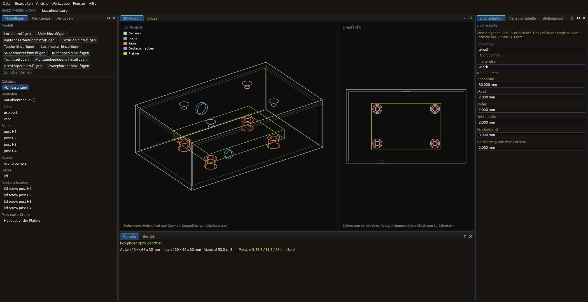
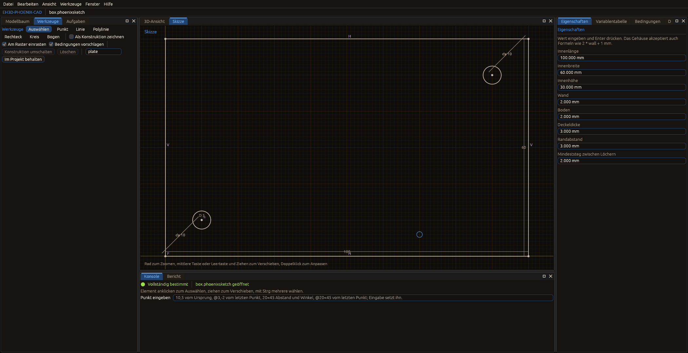
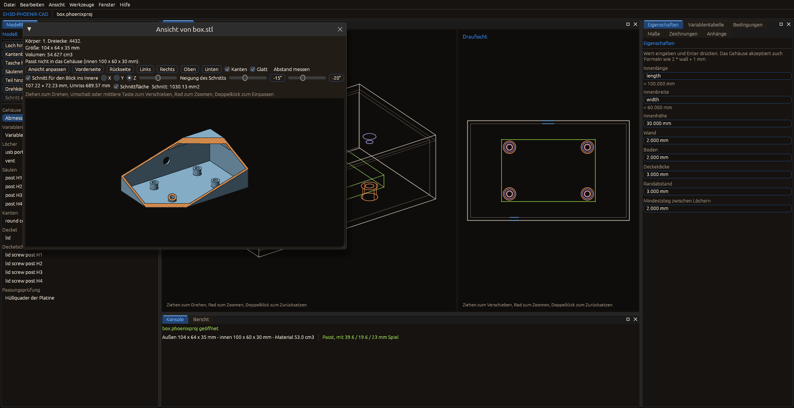
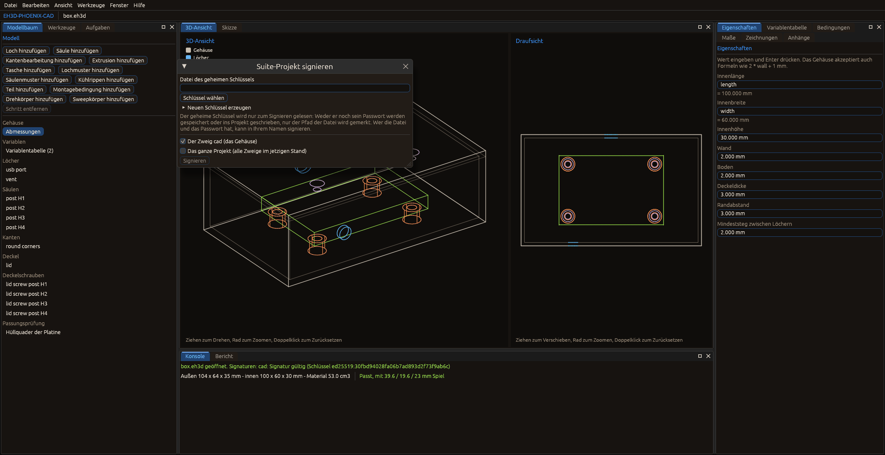
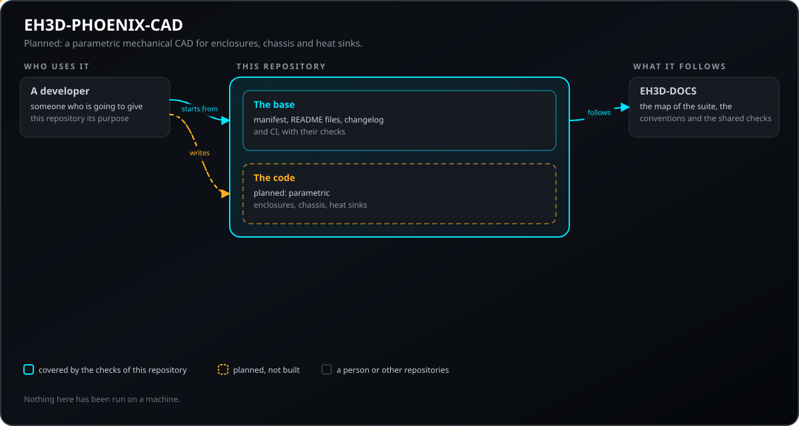
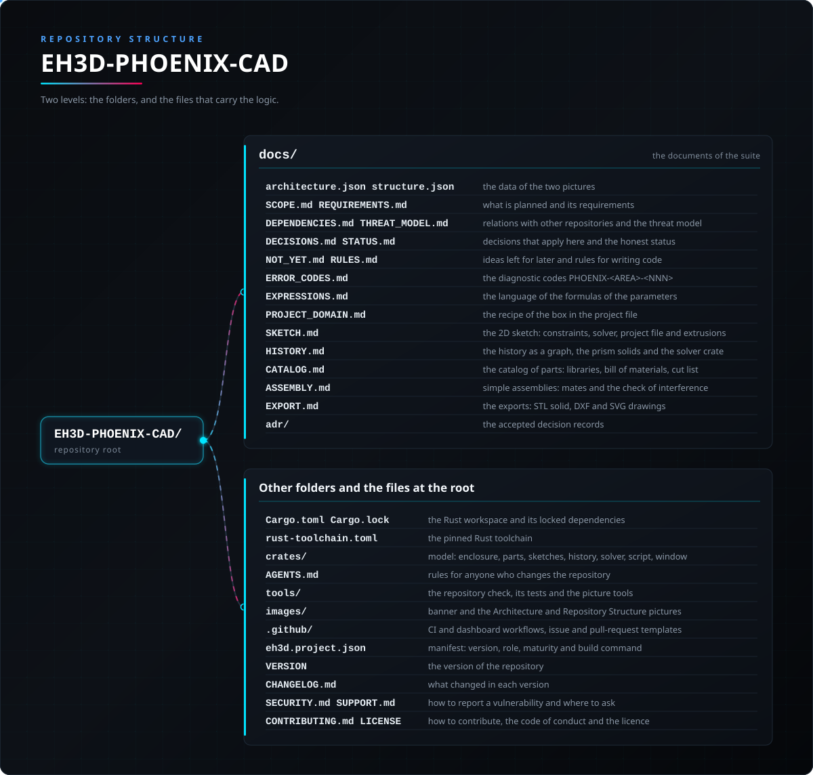

<p align="center">
  
</p>

#  EH3D-PHOENIX-CAD
<p align="center"><a href="README.md">🇺🇸 English</a> | <a href="README_spa.md">🇪🇸 Español</a> | <a href="README_fra.md">🇫🇷 Français</a> | <a href="README_ita.md">🇮🇹 Italiano</a> | 🇩🇪 <b>Deutsch</b> | <a href="README_zho.md">🇨🇳 中文</a> | <a href="README_jpn.md">🇯🇵 日本語</a> | <a href="README_por.md">🇵🇹 Português</a></p>

### EH3D-PHOENIX-CAD: geplant als ein parametrisches mechanisches CAD für den Entwurf von Gehäusen, Chassis und Kühlkörpern. Ein erstes Modell für Gehäuse existiert als Bibliothek mit einem Fenster, das noch nie auf einem Bildschirm geöffnet wurde; nichts wurde auf einer Maschine ausgeführt.

<p align="center">
  
  
  
  
  
  
</p>

---

**Ehrlichkeitscheck - was heute tatsächlich läuft:** eine Rust-Bibliothek mit einem parametrischen Gehäuse: Längen in ganzzahligen Nanometern mit eigenem Bereich, Löcher in den Flächen (rund, gesenkt, mit Senkung für den Kopf, rechteckig und oval), abgerundete und angefaste Kanten, Parameter als Formeln mit Einheiten über Variablen, Konstanten und andere Parameter (exakte Brüche, geprüfter Überlauf), strukturierte Änderungsoperationen, die Konflikte melden und das Modell unverändert lassen, Pfosten unter den Montagelöchern einer Platine mit einem daran verschraubten Deckel, das Rezept des Gehäuses im mechanischen Bereich der Projektdatei, ein Skript im OpenSCAD-Stil und eine Passprüfung gegen die Hüllgröße einer Platine. Ein Fenster (egui, mit `--features gui`) zeigt den Baum des Modells, die Eigenschaften jedes Elements, eine 3D-Ansicht und eine Draufsicht (in denen Löcher und Säulen mit der Maus gezogen und Abstände und Winkel gemessen werden; das Skript, die STEP-Datei und der Passungsbericht werden über ein Menü in eine Datei geschrieben, nie über eine vorhandene Datei, außer das Kästchen dafür ist angekreuzt; ein Berichte-Menü zeigt den Zuschnittplan, die Bohrungsliste, den Abstand zwischen Teilen, die Positionen, die Masse mit dem Schwerpunkt und die Zeichnung einer Skizze als Text in den acht Sprachen), und ein Befehl `check` liest ein Projekt und gibt seine Maße, die Passung und den Zustand jedes Schritts aus; die Logik des Fensters wird ohne Bildschirm getestet. Sie hat 1831 eigene Tests, die auf einem Computer bestehen. Sie wurde nur mit Modellen aus ihren eigenen Tests erprobt; das Fenster wurde noch nie auf einem Bildschirm geöffnet und nichts wurde auf einer Maschine ausgeführt, und die STEP-Datei, die sie schreibt, wurde nur von diesem Programm zurückgelesen, und die 2D-Skizze (Geometrie, Bedingungen, ein Löser und ein Fenster zum Zeichnen und Bemaßen), die in der Projektdatei gespeichert wird und deren geschlossene Konturen als Schritte des Rezepts von einer Fläche aus extrudiert oder in sie eingeschnitten werden können, wurde nur mit Skizzen aus ihren eigenen Tests erprobt und ihr Fenster wurde noch nicht auf einem Bildschirm geöffnet, während Muster aus Löchern und Säulen sowie Kühlrippen (mit einer einfachen Schätzung der Wärme, die sie an ruhige Luft abgeben, mit keiner Messung verglichen) zwar existieren, aber nur an Modellen aus den eigenen Tests erprobt wurden, und dasselbe gilt für die Teile eines Katalogs (auf Länge geschnittene Profile, Schrauben und Winkel, aus Bibliotheksdateien gelesen und im Modell platziert, mit Stückliste, Zuschnittliste sowie Volumen und Masse nach der Dichte des jeweiligen Materials; die Bibliothek der Beispiele ist erfunden), und dasselbe gilt für die einfachen Baugruppen aus diesen Teilen (ein Teil, das entlang einer Achse mit einem Abstand, einer Ausrichtung oder einem Stapeln gegen ein anderes gesetzt wird, und eine Prüfung, welche Teile Volumen teilen, mit den exakten Formen von Profilen, Winkeln und Schrauben, wobei eine Schraube durch das Loch eines Winkels erlaubt ist; die beiden Beispielbaugruppen sind erfunden). Der Körper des Modells lässt sich als STL-Datei schreiben (binär oder Text, mit einer geschlossenen Oberfläche, die gegen das exakte Volumen geprüft wird; manche Formen werden abgelehnt), und der Grundriss, die Vorder- und die Seitenansicht als DXF- und SVG-Zeichnungen, über das Menü Exportieren oder mit dem Befehl `export`; keine dieser Dateien wurde in einem Slicer, einem CAD- oder einem Zeichenprogramm geöffnet. STEP-Dateien von Körpern aus ebenen Flächen, Zylindern und Kegeln können gelesen werden (das Profil einer Skizze, zu einem Prisma erhoben, wird als solche geschrieben), Masse und Trägheit des Gelesenen werden aus seinen Dreiecken berechnet, und eine DXF-Zeichnung des Gehäuses kann das Blatt einer Papiergröße in einem Normmaßstab tragen; kein CAD-Programm hat diese Dateien geöffnet. Auf der Kommandozeile lässt sich ein Netz auf Druckbarkeit prüfen (Hüllen, Geschlecht, offene Kanten, nach innen gekehrte Oberflächen, Trägheitsradien), verschweißen und richtig herum drehen; Werte und Winkel lassen sich umrechnen (Zoll als Brüche, Grad-Minuten-Sekunden), Lochkreise auflisten, die Kosten einer Stückliste mit einer Steuer aufteilen, Punkte messen, Einstellungen mit den Standardwerten vergleichen, Skizzen zusammenfassen und neue Projekte aus Vorlagen beginnen; nichts davon wurde an einer Maschine erprobt. Dateien anderer Programme lassen sich lesen und schreiben (komprimierte 3MF-Pakete, tolerantes STL, PLY, OFF, DXF-Flächen, facettiertes STEP und SVG-Zeichnungen), Körper lassen sich umwandeln, skalieren, drehen, spiegeln, in Mustern wiederholen, mit einer Ebene oder einem Quader schneiden und im Schnitt darstellen, und Grenzmaße und Passungen nach ISO 286 werden aus einer nicht geprüften Tabelle berechnet; nichts davon wurde mit Dateien anderer Programme oder an einer Maschine erprobt. Der Verlauf eines Entwurfs ist ein Abhängigkeitsgraph (Parameter mit Formeln und Einheiten, Operationen auf achsenparallelen Quadern mit exakten Booleschen Operationen, ein Neuaufbau, der nur tut, was eine Änderung berührt, ein Fehler mit Code für jeden Knoten und der Befehl `history-check`), der numerische Kern des Skizzenlösers ist ein eigenes Crate, und das Fenster ist mit dem Dock-Rahmen der Suite aufgebaut (Bedienfelder, die entfernt, wieder eingesetzt, verschoben, schwebend gemacht und eingeklappt werden können, Arbeitsbereiche und eine Menüleiste); das wurde nur an Verläufen aus den eigenen Tests ausprobiert, und das Fenster wurde nie auf einem Bildschirm geöffnet. Die 2D-Zeichenblätter (Ansichten der Körper des Verlaufs mit sichtbaren und verdeckten Kanten, über Ids an Knoten des Verlaufs und an Skizzen gebundene Maße, die einer Änderung folgen und verwaiste benennen, Ebenen, Positionsnummern, die an die aus dem Verlauf abgeleitete Stückliste mit unveränderlichen Nummern gebunden sind, Schnitte mit Schraffur und Einzelheiten, ISO-286-Toleranzen, Ketten- und Koordinatenbemaßung, eine Änderungstabelle, ein Schriftfeld, unterbrochene Ansichten, Notizen mit Hinweislinie, freie Attribute der Teile, SVG-, PDF- und DXF-Dateien, die Befehle `drawing-check` und `drawing-export` und ein Fensterbereich) wurden nur an Körpern und Skizzen aus den eigenen Tests ausprobiert, und keine Datei wurde in einem Zeichenprogramm geöffnet. Ein Projekt kann außerdem im Zweig `cad` einer einzigen `.eh3d`-Datei der Suite liegen, in der jedes Programm seinen eigenen Zweig führt: Dieses Programm baut ein Gehäuse um die Platine, die der Zweig `pcb` beschreibt, meldet, wenn sich die Platine geändert hat, verschiebt die Dome mit ihren Bohrungen, prüft, ob die Grundflächen der Bauteile Platz haben, schneidet die Öffnungen der Steckverbinder und gibt STL, flache Seiten und Dome zurück; Auswahlausdrücke über die stabilen Namen und eine Tabelle der Parameter gegen ihre Grenzen ergänzen das. Das Platinenprogramm schreibt diese Beschreibung noch nicht, daher wurde dies nur mit von den Tests erfundenen Platinen erprobt. Das Menü Datei des Fensters öffnet und speichert eine solche Datei, listet ihre Zweige, bewahrt das Original eines Imports auf und übernimmt die Platine für das Gehäuse, und der Befehl `sketch-check` meldet, was in einer Skizzendatei falsch oder nur beinahe richtig ist; nichts davon wurde auf einem Bildschirm gesehen oder an einem echten Entwurf erprobt. Ein Projekt kann Varianten (benannte Werte seiner Variablen) behalten, die angewendet, geprüft und in je eine Datei exportiert werden, ein Maß einer Skizze kann ein Referenzmaß sein (es wird abgelesen und hält nichts), und das Fenster bearbeitet Titel und Beschreibung eines `.eh3d`-Projekts und prüft die Signaturen seiner Zweige mit vertrauten öffentlichen Schlüsseln; erprobt wurde das nur von den Tests, und die neuen Fenster wurden nie auf einem Bildschirm gesehen. Eine Variante kann außerdem Schritte ab- und einschalten, eine Variable kann einem Referenzmaß einer Skizze folgen, und die Varianten werden mit ihren Kennzahlen als Tabelle geschrieben und gelesen; auch das haben nur die Tests erprobt. Die STEP-Datei enthält das ganze Modell: Extrusionen, Taschen und Kühlrippen als Teil des Gehäuses sowie die platzierten Teile und die Dreh- und Sweep-Körper als Körper aus ebenen Flächen; kein CAD-Programm hat sie geöffnet.

---

> **Stand von Sicherheit und IT-Sicherheit:** dieses Repository steht am Anfang und ist kein Sicherheitssystem (Safety). Nichts hier Geschriebenes ersetzt die Grenzen, Verriegelungen und den Not-Aus der Maschine und ihrer Steuerung.

## 📋 Auf einen Blick

| | |
|---|---|
| Version | `0.1.6` |
| Reifegrad | Gerüst |
| Tests | 1831 |
| Technologie-Stack | Rust, Markdown, Python 3.10+ |
| Auf echter Hardware | Noch nicht auf Hardware ausgeführt |

**Springe zu:** [Überblick](#-überblick) · [Architektur](#-architektur) · [Schnellstart](#-schnellstart) · [Tests](#-tests) · [Struktur des Repositorys](#-struktur-des-repositorys) · [Verwandte Projekte](#-verwandte-projekte)

## 🚦 Projektstatus

Jede Zeile ist ein Teil dieses Repositorys, und die Ampel sagt, wie weit er heute ist. Sie beruht auf dem, was das Repository zeigen kann (Tests, Builds, Läufe), nicht auf dem, was geplant ist.

🟢 Fertig und überprüft · 🟡 Funktioniert, mit bekannten Grenzen · 🟠 Teilweise fertig oder noch nicht überprüft · 🔴 Nicht gemacht oder funktioniert nicht

| Bereich | Stand | Was das hier bedeutet |
|---|---|---|
| Repository-Prüfungen | 🟡 | Die Repository-Prüfung, die Prüfung der Bilder und die 4 Tests der Basis laufen in der CI und bestehen. |
| Tests | 🟡 | Die 1831 Tests der Rust-Bibliothek und die 4 der Basis bestehen auf einem Computer. Sie nutzen nur Modelle, die die Tests selbst erzeugen. |
| Echte Hardware | 🟠 | Auf keiner Maschine und keiner Platine ausgeführt: nichts hier wurde auf Hardware ausprobiert. |
| Geplante Funktion | 🟠 | Teilweise fertig: ein parametrisches Gehäuse mit Löchern, Pfosten und einem verschraubten Deckel, ein Skript im OpenSCAD-Stil, eine Passprüfung und das Rezept des Gehäuses in der Projektdatei existieren, dazu ein erster STEP-Schreiber, dessen Dateien nur dieses Programm gelesen hat; eine 2D-Skizze mit Bedingungen, einem Löser und einem Fenster zum Zeichnen existiert, wird in der Projektdatei gespeichert und kann von einer Fläche aus extrudiert oder in sie eingeschnitten werden, ihr Fenster wurde aber noch nicht auf einem Bildschirm geöffnet; Muster aus Löchern und Säulen sowie Kühlrippen mit einer Schätzung ihrer Wärme existieren und wurden nur an Modellen der Tests erprobt; Teile eines Katalogs (Profile, Schrauben und Winkel aus Bibliotheksdateien), im Modell platziert und mit Stückliste und Masse je Material, existieren und wurden nur an erfundenen Teilen erprobt; einfache Baugruppen aus diesen Teilen (ein Teil entlang einer Achse gegen ein anderes gesetzt und eine Prüfung, welche Teile Volumen teilen) existieren und wurden nur an erfundenen Teilen erprobt. Es gibt 2D-Zeichenblätter mit Ansichten, Maßen, die dem Modell folgen, Ebenen und an die Stückliste gebundenen Positionsnummern, erprobt nur an Körpern aus den Tests. |
| Anforderungen | 🟠 | 37 von 38 Anforderungen sind Prototyp (FCAD-001 und FCAD-003 bis FCAD-038, siehe docs/REQUIREMENTS.md), 1 ist nur geplant und keine ist validiert. |

## 🎯 Überblick

* **Geplant:** EH3D-PHOENIX-CAD soll ein parametrisches mechanisches CAD für den Entwurf von Gehäusen, Chassis und Kühlkörpern werden, als Bibliothek mit Fenster, mit Kommandozeile und, wo es passt, einer Art Serveraufgabe. Die Bibliothek existiert mit einem ersten parametrischen Gehäuse, einem Fenster, das Baum, Eigenschaften, eine 3D-Ansicht und eine Draufsicht zeigt, in denen Löcher und Säulen mit der Maus gezogen und Abstände und Winkel gemessen werden (noch nie auf einem Bildschirm geöffnet), und einem Befehl `check`; die Serveraufgabe gibt es noch nicht, die Kühlrippen (mit einer Schätzung ihrer Wärme) sind nicht in der STEP-Datei, und die STEP-Datei wurde nur von diesem Programm zurückgelesen.
* **Anhänge des Projekts:** Das Fenster hat den Bereich „Anhänge“ der Suite (Ansicht oder *Datei > Suite-Projekt*): Datenblätter, Handbücher und andere Dateien des `.eh3d`-Projekts werden aufgelistet, angehängt (eine Datei oder nur ein Link), mit einem Bauteil verknüpft, nach Rückfrage entpackt und entfernt und neben der Liste angezeigt; Programme, Skripte und unbekannte Typen fragen nach, bevor sie das Projekt verlassen, nichts wird heruntergeladen, und die Pakete enthalten die PDF-Bibliothek (PDFium) mit ihren Lizenzen. Nur durch Tests erprobt, nie auf einem Bildschirm.
* **Dateien anderer Programme im Fenster ansehen:** ein 3D- oder flacher DXF-Anhang des Projekts, das beim Import aufbewahrte Original oder eine Datei der Festplatte (*Datei > 3D- oder DXF-Datei ansehen*, `--viewer DATEI`) wird als schattierter Körper oder als Linien gezeigt, mit Größe, Volumen bei geschlossener Fläche, ob er in das Gehäuse passt, geraden Ansichten und dem Abstand zweier Ecken. Nichts wird geschrieben; die Grenzen stehen im Abschnitt `[model_view]`. Die Oberfläche lässt sich zwischen ihren scharfen Kanten glätten und beim Aufschneiden mit einer schraffierten Fläche schließen, deren Inhalt angegeben wird. Der Schnitt kann gegen seine Achse geneigt werden, und der Querschnitt wird vermessen (Breite, Höhe, Umriss, Fläche und Abstände darauf).
* **Das Suite-Projekt signieren:** *Suite-Projekt > Suite-Projekt signieren* und die Befehle `eh3d-keygen` und `eh3d-sign` signieren den Zweig `cad` oder das ganze Projekt mit einer geheimen Ed25519-Schlüsseldatei, die nur gelesen wird; bevor das Fenster etwas schreibt, das eine Signatur entfernen würde, fragt es (Eingabe und Esc schreiben nichts); die Befehle fragen nicht, sie sagen, dass sie entfernt wurde. Die Schlüsseldatei kann durch ein Passwort geschützt sein (neue Schlüssel erzeugt das Fenster so, und es bietet an, einen alten zu schützen), nur der Pfad des Schlüssels wird gemerkt, und die Signatur eines anderen Schlüssels wird nur mit Zustimmung ersetzt.
* **Ein von einem anderen Programm gespeichertes Projekt wird nicht überschrieben:** Das Fenster merkt sich den Stand, den es geöffnet oder gespeichert hat; hat inzwischen ein anderes Programm die `.eh3d`-Datei geschrieben, schreibt es nichts und bietet an, sie neu zu lesen oder unter einem anderen Namen zu speichern.

## 🧩 Rolle in EH3D

EH3D-PHOENIX-CAD gehört zur PHOENIX-Familie der EH3D Fabrication Suite. Was es tun wird, was es noch nicht tun wird, seine Anforderungen und seine Beziehungen zu anderen Repositories stehen im Ordner `docs/`.

<p align="center">
  
  
  
  
</p>

## 🏛️ Architektur

<p align="center">
  
</p>

Wie die Teile dieses Repositorys zusammenpassen: wer es nutzt, was es enthält und wovon es abhängt. Das Bild wird aus `docs/architecture.json` gezeichnet und gegen den Code geprüft.

## 🚀 Schnellstart

Du brauchst Python 3.10 oder neuer; es gibt nichts zu installieren.

```bash
python -I tools/ci_validate.py
python -I tools/make_architecture.py --check
python -I tools/make_structure.py --check --readmes
python -I -m unittest discover -s tools -p "test_*.py"
```

Zum Ausprobieren des Programms (es braucht Rust; das Fenster braucht `--features gui`):

```bash
cargo run -p eh3d-phoenix-cad -- check crates/eh3d-phoenix-cad/examples/box.phoenixproj
cargo run -p eh3d-phoenix-cad -- eh3d-save crates/eh3d-phoenix-cad/examples/box.phoenixproj job.eh3d
cargo run -p eh3d-phoenix-cad -- eh3d-info job.eh3d
cargo run -p eh3d-phoenix-cad -- eh3d-keygen --out mine.key
cargo run -p eh3d-phoenix-cad -- eh3d-sign job.eh3d --key mine.key
cargo run -p eh3d-phoenix-cad -- variants job.eh3d --check --text
cargo run -p eh3d-phoenix-cad -- variants job.eh3d --figures
cargo run -p eh3d-phoenix-cad -- variables job.eh3d --text
cargo run -p eh3d-phoenix-cad -- select job.eh3d "edges|Z"
cargo run -p eh3d-phoenix-cad -- params job.eh3d --text
cargo run -p eh3d-phoenix-cad -- panels job.eh3d faces.svg
cargo run -p eh3d-phoenix-cad -- check crates/eh3d-phoenix-cad/examples/plate.phoenixproj
cargo run -p eh3d-phoenix-cad -- check crates/eh3d-phoenix-cad/examples/frame.phoenixproj
cargo run -p eh3d-phoenix-cad -- bill crates/eh3d-phoenix-cad/examples/frame.phoenixproj
cargo run -p eh3d-phoenix-cad -- library crates/eh3d-phoenix-cad/examples/chassis.phoenixlib
cargo run -p eh3d-phoenix-cad -- check crates/eh3d-phoenix-cad/examples/assembly.phoenixproj
cargo run -p eh3d-phoenix-cad -- interference crates/eh3d-phoenix-cad/examples/assembly.phoenixproj
cargo run -p eh3d-phoenix-cad -- balance crates/eh3d-phoenix-cad/examples/frame.phoenixproj
cargo run -p eh3d-phoenix-cad -- sketch-export crates/eh3d-phoenix-cad/examples/box.phoenixsketch --format dxf --out box-sketch.dxf
cargo run -p eh3d-phoenix-cad -- holes crates/eh3d-phoenix-cad/examples/box.phoenixproj --tools
cargo run -p eh3d-phoenix-cad -- placements crates/eh3d-phoenix-cad/examples/assembly.phoenixproj --explode 50
cargo run -p eh3d-phoenix-cad -- clearance crates/eh3d-phoenix-cad/examples/assembly.phoenixproj
cargo run -p eh3d-phoenix-cad -- cutplan crates/eh3d-phoenix-cad/examples/frame.phoenixproj --text
cargo run -p eh3d-phoenix-cad -- holes crates/eh3d-phoenix-cad/examples/box.phoenixproj --text --lang es
cargo run -p eh3d-phoenix-cad -- balance crates/eh3d-phoenix-cad/examples/frame.phoenixproj --lang de
cargo run -p eh3d-phoenix-cad -- revolve crates/eh3d-phoenix-cad/examples/plate.phoenixproj --axis y --angle 90 --material PLA
cargo run -p eh3d-phoenix-cad -- export crates/eh3d-phoenix-cad/examples/box.phoenixproj --format stl --out box.stl
cargo run -p eh3d-phoenix-cad -- export crates/eh3d-phoenix-cad/examples/box.phoenixproj --format svg --view front --out box-front.svg
cargo run --release -p eh3d-phoenix-cad --features gui -- crates/eh3d-phoenix-cad/examples/box.phoenixproj
cargo run --release -p eh3d-phoenix-cad --features gui -- gui crates/eh3d-phoenix-cad/examples/box.phoenixproj --shot box.png
cargo run --release -p eh3d-phoenix-cad --features gui -- gui crates/eh3d-phoenix-cad/examples/box.phoenixsketch --view sketch --shot sketch.png
```

## 🧪 Tests

Die Rust-Bibliothek hat 1831 Tests (`cargo test`) und die Basis hat 4 (`python -I -m unittest discover -s tools -p "test_*.py"`); alle bestehen auf einem Computer. Die CI führt die Repository-Prüfung, die Prüfung der Bilder, die Tests der Basis und für den Rust-Code die Formatprüfung, clippy mit Warnungen als Fehlern und die Tests unter Linux und Windows aus und prüft außerdem das Fenster mit clippy (`--features gui`). Die Zahl oben zählt auch die Beispiele der Dokumentation, und die CI schlägt fehl, wenn die README-Dateien eine andere nennen.

## 🏗️ Build und Veröffentlichung

Die Version steht in der Datei `VERSION` und in `eh3d.project.json`, und jede Version hat ihren Eintrag in [CHANGELOG.md](CHANGELOG.md). Das Programm wird mit `cargo build --release` gebaut (das Fenster mit `--features gui`); Releases werden auf GitHub veröffentlicht.

## 📂 Struktur des Repositorys

<p align="center">
  
</p>

<details>
<summary>Textversion des Baums</summary>

```text
EH3D-PHOENIX-CAD/
├── docs/
│   ├── architecture.json structure.json         die Daten der beiden Bilder
│   ├── SCOPE.md REQUIREMENTS.md                 das Geplante und seine Anforderungen
│   ├── DEPENDENCIES.md THREAT_MODEL.md          Beziehungen zu anderen Repositories und Bedrohungsmodell
│   ├── DECISIONS.md STATUS.md                   hier geltende Entscheidungen und ehrlicher Status
│   ├── NOT_YET.md RULES.md                      Ideen für später und Regeln zum Schreiben von Code
│   ├── ERROR_CODES.md                           die Diagnosecodes PHOENIX-<BEREICH>-<NNN>
│   ├── EXPRESSIONS.md                           die Sprache der Formeln der Parameter
│   ├── PROJECT_DOMAIN.md                        das Rezept des Gehäuses in der Projektdatei
│   ├── SKETCH.md                                die 2D-Skizze: Bedingungen, Löser, Projektdatei und Extrusionen
│   ├── HISTORY.md                               der Verlauf als Graph, die Quaderkörper und das Löser-Crate
│   ├── DRAWING.md                               die Zeichenblätter: Ansichten, Maße, Positionsnummern, Ebenen
│   ├── CATALOG.md                               der Teilekatalog: Bibliotheken, Stückliste, Zuschnittliste
│   ├── ASSEMBLY.md                              einfache Baugruppen: Bedingungen und Durchdringungsprüfung
│   ├── BOARD_INTERCHANGE.md                     Platine und Gehäuse in einer .eh3d-Datei
│   ├── EXPORT.md                                die Exporte: STL-Körper, DXF- und SVG-Zeichnungen
│   └── adr/                                     die angenommenen Entscheidungsprotokolle
├── Cargo.toml Cargo.lock                        der Rust-Workspace und seine festgelegten Abhängigkeiten
├── rust-toolchain.toml                          die festgelegte Rust-Toolchain
├── crates/                                      Modell: Gehäuse, Teile, Skizzen, Verlauf, Löser, Skript, Fenster
├── AGENTS.md                                    Regeln für alle, die das Repository ändern
├── tools/                                       die Repository-Prüfung, ihre Tests und die Bild-Werkzeuge
├── images/                                      Banner und die Bilder von Architektur und Repository-Struktur
├── .github/                                     CI- und Dashboard-Workflows, Vorlagen für Issues und Pull Requests
├── eh3d.project.json                            Manifest: Version, Rolle, Reifegrad und Build-Befehl
├── VERSION                                      die Version des Repositorys
├── CHANGELOG.md                                 was sich in jeder Version geändert hat
├── SECURITY.md SUPPORT.md                       Schwachstellen melden und Fragen stellen
└── CONTRIBUTING.md CODE_OF_CONDUCT.md LICENSE   Mitwirken, Verhaltenskodex und Lizenz
```

</details>

## 🗺️ Roadmap und bekannte Grenzen

**Bekannte Grenzen heute**

* Früher Code: das Modell eines Gehäuses mit seinen Skizzen, Extrusionen und Taschen, erprobt mit Modellen aus seinen eigenen Tests; nichts wurde auf einer Maschine ausgeführt und keine Anforderung ist validiert.

**Als Nächstes**

* Das Platinenwerkzeug die mechanische Domäne des Projektformats lesen und schreiben lassen, die STEP-Datei in einem CAD-Programm öffnen und danach die Baugruppen über Bedingungen entlang einer Achse hinaus erweitern und die Schätzung der Kühlrippen mit einer Messung vergleichen, jeweils mit Tests.

## 🌍 Sprachen

README und Texte gibt es auf Englisch, Spanisch, Französisch, Italienisch, Deutsch, Chinesisch, Japanisch und europäischem Portugiesisch.

## 🔗 Verwandte Projekte

* [EH3D-DOCS](https://github.com/JuanenRac/EH3D-DOCS): die Karte der Suite, ihre Architektur, die Konventionen und die gemeinsamen Prüfungen
* [EH3D-COMMON](https://github.com/JuanenRac/EH3D-COMMON): die Objektidentität (UUID v7), die die Löcher verwenden; später der Projektcontainer und das Diagnose-Crate
* Geplante Beziehungen, noch nicht gebaut (EH3D-PHOENIX-PCB, EH3D-THERMAL-LAB): siehe [docs/DEPENDENCIES.md](docs/DEPENDENCIES.md)

## 📚 Dokumentation

* [Die Konventionen der Suite](https://github.com/JuanenRac/EH3D-DOCS/blob/main/docs/CONVENTIONS.md)
* [Änderungsprotokoll](CHANGELOG.md)
* [Umfang, Anforderungen, Abhängigkeiten, Bedrohungsmodell und Entscheidungen](docs/SCOPE.md)
* [Die Verbindung zum EH3D-Server: dort gespeicherte Projekte und Berichte](docs/SERVER.md)
* [Platine und Gehäuse in einem Projekt der Suite (`.eh3d`)](docs/BOARD_INTERCHANGE.md)

## 🤝 Mitwirken und Community

* Führe vor einem Pull Request `python -I tools/ci_validate.py` und die Tests der Basis aus: alles muss bestehen. Siehe [CONTRIBUTING.md](CONTRIBUTING.md) und den [Verhaltenskodex](CODE_OF_CONDUCT.md).
* Das README gibt es in acht Sprachen: Eine Textänderung wird in allen acht Dateien gemacht, und die beiden Bilder werden aus `docs/architecture.json` und `docs/structure.json` mit `tools/make_architecture.py` und `tools/make_structure.py` gezeichnet.
* Melde eine Schwachstelle privat: [SECURITY.md](SECURITY.md). Fragen, Ideen und Meldungen: electrohobby3d@gmail.com ([SUPPORT.md](SUPPORT.md)).

## 👤 AUTOR

**JuanenRac (Electro Hobby 3D)** · electrohobby3d@gmail.com

## 📜 LIZENZ

Software: GPL-3.0-or-later. Siehe [LICENSE](LICENSE). Die Hardware-Entwürfe der Suite verwenden die CERN OHL-S.
