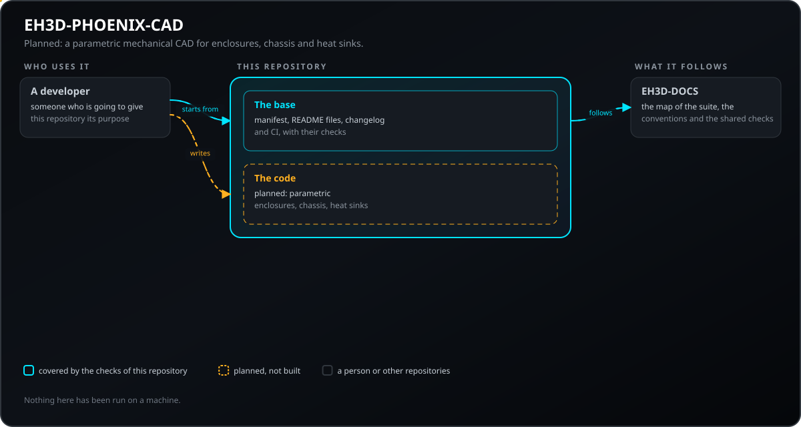
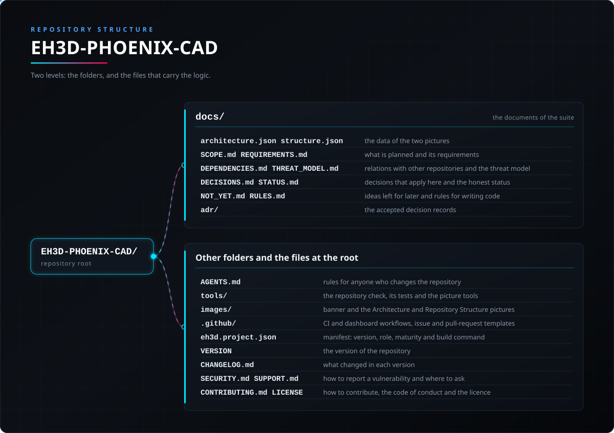

<p align="center">
  
</p>

#  EH3D-PHOENIX-CAD
<p align="center"><a href="README.md">🇺🇸 English</a> | <a href="README_spa.md">🇪🇸 Español</a> | <a href="README_fra.md">🇫🇷 Français</a> | <a href="README_ita.md">🇮🇹 Italiano</a> | 🇩🇪 <b>Deutsch</b> | <a href="README_zho.md">🇨🇳 中文</a> | <a href="README_jpn.md">🇯🇵 日本語</a> | <a href="README_por.md">🇵🇹 Português</a></p>

### EH3D-PHOENIX-CAD: geplant als ein parametrisches mechanisches CAD für den Entwurf von Gehäusen, Chassis und Kühlkörpern. Ein erstes Modell für Gehäuse existiert als Bibliothek; nichts wurde auf einer Maschine ausgeführt.

<p align="center">
  
  
  
  
  
  
</p>

---

**Ehrlichkeitscheck - was heute tatsächlich läuft:** eine Rust-Bibliothek ohne Fenster mit einem parametrischen Gehäuse: Längen in ganzzahligen Nanometern mit eigenem Bereich, runde Löcher in den Flächen, strukturierte Änderungsoperationen, die Konflikte melden und das Modell unverändert lassen, ein Skript im OpenSCAD-Stil und eine Passprüfung gegen die Hüllgröße einer Platine. Sie hat 118 eigene Tests, die auf einem Computer bestehen. Sie wurde nur mit Modellen aus ihren eigenen Tests erprobt; nichts wurde gezeichnet oder auf einer Maschine ausgeführt, und die STEP-Datei, die sie schreibt, wurde nur auf ihre Struktur geprüft, und Kühlkörper, Skizzen und Baugruppen sind nur geplant.

---

> **Stand von Sicherheit und IT-Sicherheit:** dieses Repository steht am Anfang und ist kein Sicherheitssystem (Safety). Nichts hier Geschriebenes ersetzt die Grenzen, Verriegelungen und den Not-Aus der Maschine und ihrer Steuerung.

## 📋 Auf einen Blick

| | |
|---|---|
| Version | `0.0.2` |
| Reifegrad | Gerüst |
| Tests | 121 |
| Technologie-Stack | Markdown, Python 3.10+ |
| Auf echter Hardware | Noch nicht auf Hardware ausgeführt |

**Springe zu:** [Überblick](#-überblick) · [Architektur](#-architektur) · [Schnellstart](#-schnellstart) · [Tests](#-tests) · [Struktur des Repositorys](#-struktur-des-repositorys) · [Verwandte Projekte](#-verwandte-projekte)

## 🚦 Projektstatus

Jede Zeile ist ein Teil dieses Repositorys, und die Ampel sagt, wie weit er heute ist. Sie beruht auf dem, was das Repository zeigen kann (Tests, Builds, Läufe), nicht auf dem, was geplant ist.

🟢 Fertig und überprüft · 🟡 Funktioniert, mit bekannten Grenzen · 🟠 Teilweise fertig oder noch nicht überprüft · 🔴 Nicht gemacht oder funktioniert nicht

| Bereich | Stand | Was das hier bedeutet |
|---|---|---|
| Repository-Prüfungen | 🟡 | Die Repository-Prüfung, die Prüfung der Bilder und die 3 Tests der Basis laufen in der CI und bestehen. |
| Tests | 🟡 | Die 118 Tests der Rust-Bibliothek und die 3 der Basis bestehen auf einem Computer. Sie nutzen nur Modelle, die die Tests selbst erzeugen. |
| Echte Hardware | 🟠 | Auf keiner Maschine und keiner Platine ausgeführt: nichts hier wurde auf Hardware ausprobiert. |
| Geplante Funktion | 🟠 | Teilweise fertig: ein parametrisches Gehäuse mit Löchern, ein Skript im OpenSCAD-Stil und eine Passprüfung existieren, dazu ein erster STEP-Schreiber, nur auf seine Struktur geprüft; Kühlkörper, Skizzen und Baugruppen sind nicht begonnen. |
| Anforderungen | 🟠 | 4 von 6 Anforderungen sind als Prototyp (Gehäuse, Skript, Änderungsoperationen und mechanischer Bereich), 2 nur geplant und keine ist validiert. |

## 🎯 Überblick

* **Geplant:** EH3D-PHOENIX-CAD soll ein parametrisches mechanisches CAD für den Entwurf von Gehäusen, Chassis und Kühlkörpern werden, als Bibliothek ohne Fenster, mit Kommandozeile und, wo es passt, einer Art Serveraufgabe. Die Bibliothek existiert mit einem ersten parametrischen Gehäuse; die Kommandozeile, die Serveraufgabe, der STEP-Export und die Kühlkörper gibt es noch nicht.

## 🧩 Rolle in EH3D

EH3D-PHOENIX-CAD gehört zur PHOENIX-Familie der EH3D Fabrication Suite. Was es tun wird, was es noch nicht tun wird, seine Anforderungen und seine Beziehungen zu anderen Repositories stehen im Ordner `docs/`.

## 🏛️ Architektur

<p align="center">
  
</p>

Wie die Teile dieses Repositorys zusammenpassen: wer es nutzt, was es enthält und wovon es abhängt. Das Bild wird aus `docs/architecture.json` gezeichnet und gegen den Code geprüft.

## 🚀 Schnellstart

Du brauchst Python 3.10 oder neuer; es gibt nichts zu installieren.

```bash
python -I tools/ci_validate.py
python -I tools/make_architecture.py --check
python -I tools/make_structure.py --check --readmes
python -I -m unittest discover -s tools -p "test_*.py"
```

## 🧪 Tests

Die Rust-Bibliothek hat 118 Tests (`cargo test`) und die Basis hat 3 (`python -I -m unittest discover -s tools -p "test_*.py"`); alle bestehen auf einem Computer. Die CI führt die Repository-Prüfung, die Prüfung der Bilder, die Tests der Basis und für den Rust-Code die Formatprüfung, clippy mit Warnungen als Fehlern und die Tests unter Linux und Windows aus.

## 🏗️ Build und Veröffentlichung

Die Version steht in der Datei `VERSION` und in `eh3d.project.json`, und jede Version hat ihren Eintrag in [CHANGELOG.md](CHANGELOG.md). Es gibt nichts zu bauen; Releases werden auf GitHub veröffentlicht.

## 📂 Struktur des Repositorys

<p align="center">
  
</p>

<details>
<summary>Textversion des Baums</summary>

```text
EH3D-PHOENIX-CAD/
├── docs/
│   ├── architecture.json structure.json         die Daten der beiden Bilder
│   ├── SCOPE.md REQUIREMENTS.md                 das Geplante und seine Anforderungen
│   ├── DEPENDENCIES.md THREAT_MODEL.md          Beziehungen zu anderen Repositories und Bedrohungsmodell
│   ├── DECISIONS.md STATUS.md                   hier geltende Entscheidungen und ehrlicher Status
│   ├── NOT_YET.md RULES.md                      Ideen für später und Regeln zum Schreiben von Code
│   ├── ERROR_CODES.md                           die Diagnosecodes PHOENIX-<BEREICH>-<NNN>
│   └── adr/                                     die angenommenen Entscheidungsprotokolle
├── Cargo.toml Cargo.lock                        der Rust-Workspace und seine festgelegten Abhängigkeiten
├── crates/                                      das mechanische Modell: Gehäuse, Operationen, Skript, Passprüfung
├── AGENTS.md                                    Regeln für alle, die das Repository ändern
├── tools/                                       die Repository-Prüfung, ihre Tests und die Bild-Werkzeuge
├── images/                                      Banner und die Bilder von Architektur und Repository-Struktur
├── .github/                                     CI- und Dashboard-Workflows, Vorlagen für Issues und Pull Requests
├── eh3d.project.json                            Manifest: Version, Rolle, Reifegrad und Build-Befehl
├── VERSION                                      die Version des Repositorys
├── CHANGELOG.md                                 was sich in jeder Version geändert hat
├── SECURITY.md SUPPORT.md                       Schwachstellen melden und Fragen stellen
└── CONTRIBUTING.md CODE_OF_CONDUCT.md LICENSE   Mitwirken, Verhaltenskodex und Lizenz
```

</details>

## 🗺️ Roadmap und bekannte Grenzen

**Bekannte Grenzen heute**

* Früher Code: Es gibt nur das Modell eines Gehäuses, erprobt mit Modellen aus seinen eigenen Tests; nichts wurde auf einer Maschine ausgeführt und keine Anforderung ist validiert.

**Als Nächstes**

* Die mechanische Domäne des Projektformats gemeinsam mit dem Platinenwerkzeug schreiben, danach die Änderungsoperationen, die daraus kommen; dann der STEP-Export, die Kühlkörper und die Kommandozeile, jeweils mit Tests.

## 🌍 Sprachen

README und Texte gibt es auf Englisch, Spanisch, Französisch, Italienisch, Deutsch, Chinesisch, Japanisch und europäischem Portugiesisch.

## 🔗 Verwandte Projekte

* [EH3D-DOCS](https://github.com/JuanenRac/EH3D-DOCS): die Karte der Suite, ihre Architektur, die Konventionen und die gemeinsamen Prüfungen
* [EH3D-COMMON](https://github.com/JuanenRac/EH3D-COMMON): die Objektidentität (UUID v7), die die Löcher verwenden; später der Projektcontainer und das Diagnose-Crate
* Geplante Beziehungen, noch nicht gebaut (EH3D-PHOENIX-PCB, EH3D-THERMAL-LAB): siehe [docs/DEPENDENCIES.md](docs/DEPENDENCIES.md)

## 📚 Dokumentation

* [Die Konventionen der Suite](https://github.com/JuanenRac/EH3D-DOCS/blob/main/docs/CONVENTIONS.md)
* [Änderungsprotokoll](CHANGELOG.md)
* [Umfang, Anforderungen, Abhängigkeiten, Bedrohungsmodell und Entscheidungen](docs/SCOPE.md)

## 🤝 Mitwirken und Community

* Führe vor einem Pull Request `python -I tools/ci_validate.py` und die Tests der Basis aus: alles muss bestehen. Siehe [CONTRIBUTING.md](CONTRIBUTING.md) und den [Verhaltenskodex](CODE_OF_CONDUCT.md).
* Das README gibt es in acht Sprachen: Eine Textänderung wird in allen acht Dateien gemacht, und die beiden Bilder werden aus `docs/architecture.json` und `docs/structure.json` mit `tools/make_architecture.py` und `tools/make_structure.py` gezeichnet.
* Melde eine Schwachstelle privat: [SECURITY.md](SECURITY.md). Fragen, Ideen und Meldungen: electrohobby3d@gmail.com ([SUPPORT.md](SUPPORT.md)).

## 👤 AUTOR

**JuanenRac (Electro Hobby 3D)** · electrohobby3d@gmail.com

## 📜 LIZENZ

Software: GPL-3.0-or-later. Siehe [LICENSE](LICENSE). Die Hardware-Entwürfe der Suite verwenden die CERN OHL-S.
