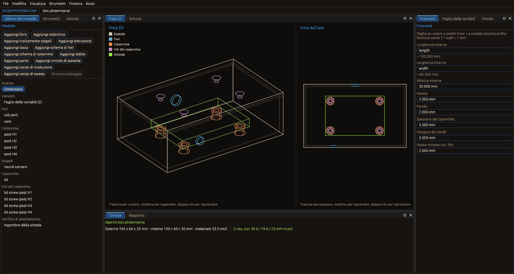
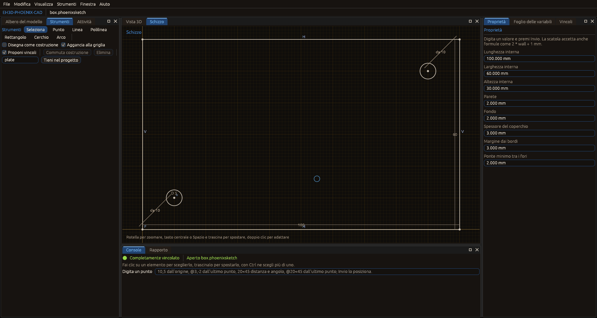
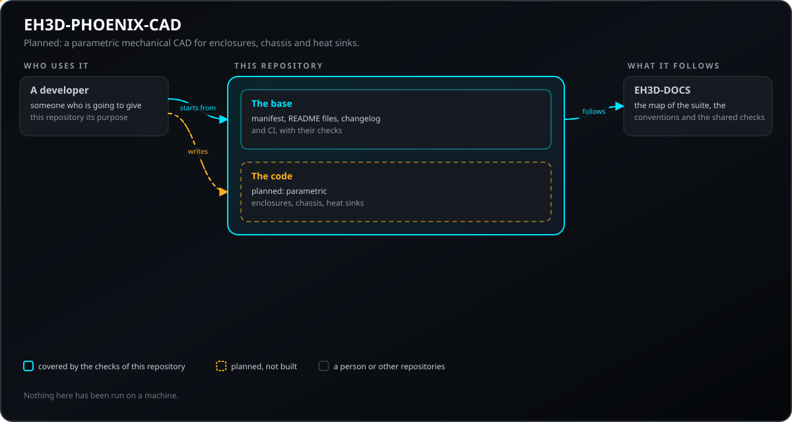
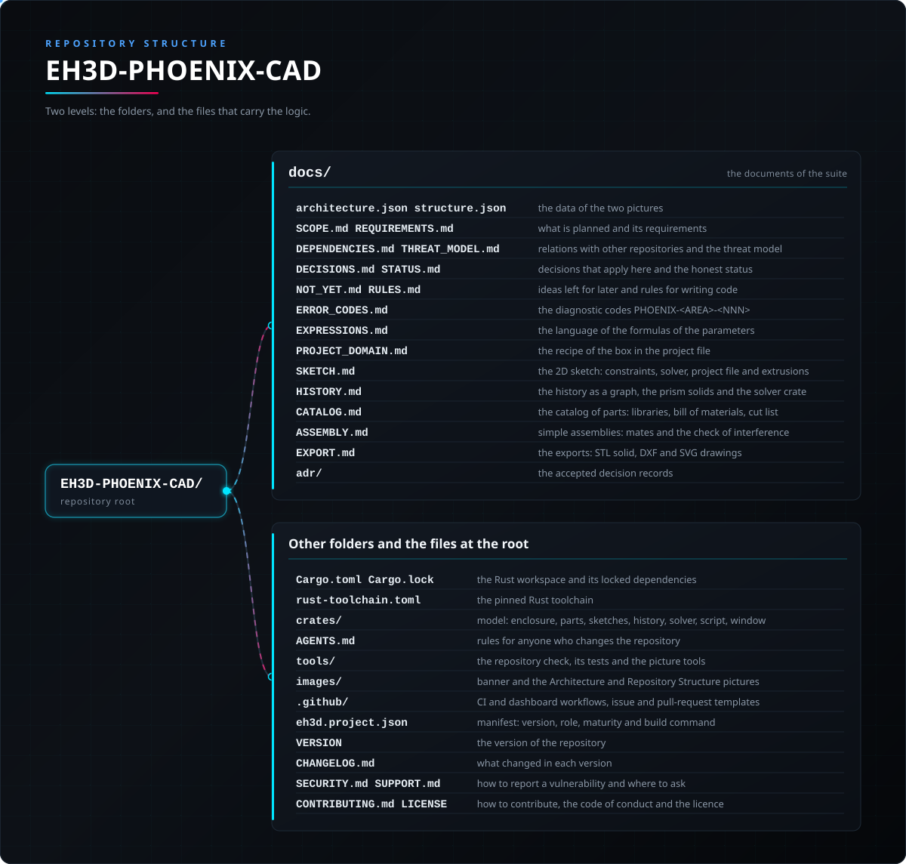

<p align="center">
  
</p>

#  EH3D-PHOENIX-CAD
<p align="center"><a href="README.md">🇺🇸 English</a> | <a href="README_spa.md">🇪🇸 Español</a> | <a href="README_fra.md">🇫🇷 Français</a> | 🇮🇹 <b>Italiano</b> | <a href="README_deu.md">🇩🇪 Deutsch</a> | <a href="README_zho.md">🇨🇳 中文</a> | <a href="README_jpn.md">🇯🇵 日本語</a> | <a href="README_por.md">🇵🇹 Português</a></p>

### EH3D-PHOENIX-CAD: pianificato come un CAD meccanico parametrico incentrato sulla progettazione di scatole, telai e dissipatori termici. Esiste un primo modello di contenitori come libreria con una finestra che non è mai stata aperta su uno schermo; nulla è stato eseguito su una macchina.

<p align="center">
  
  
  
  
  
  
</p>

---

**Verifica di onestà - cosa funziona oggi:** una libreria Rust con un contenitore parametrico: lunghezze in nanometri interi con un proprio intervallo, fori nelle facce (rotondi, svasati, con spianatura per la testa, rettangolari e ovali), spigoli arrotondati e smussati, parametri scritti come formule con unità su variabili, costanti e altri parametri (frazioni esatte, overflow controllato), operazioni di modifica strutturate che segnalano i conflitti e lasciano il modello intatto, colonnine sotto i fori di fissaggio di una scheda con un coperchio avvitato su di esse, la ricetta del contenitore conservata nel dominio meccanico del file di progetto, uno script in stile OpenSCAD e un controllo di alloggiamento rispetto all'ingombro di una scheda. Una finestra (egui, con `--features gui`) mostra l'albero del modello, le proprietà di ogni elemento, una vista 3D e una vista dall'alto (dove si trascinano fori e colonnine con il mouse e si misurano distanze e angoli; lo script, il file STEP e il rapporto di adattamento si scrivono in un file da un menu, mai sopra un file esistente a meno che la casella apposita sia spuntata; un menu Rapporti mostra il piano di taglio, la tabella dei fori, il gioco tra le parti, le posizioni, la massa e il baricentro e il disegno di uno schizzo come testo nelle otto lingue), e un comando `check` legge un progetto e stampa le sue misure, l'alloggiamento e lo stato di ogni passaggio; la logica della finestra è provata senza schermo. Ha 1784 test propri e passano su un computer. È stata provata solo su modelli creati dai suoi stessi test; la finestra non è mai stata aperta su uno schermo e nulla è stato eseguito su una macchina, e il file STEP che scrive è stato controllato solo nella struttura, e lo schizzo 2D (geometria, vincoli, un risolutore e una finestra per disegnarlo e quotarlo), che è conservato nel file di progetto e i cui contorni chiusi possono essere estrusi da una faccia o scavati in essa come passi della ricetta, è stato provato solo su schizzi creati dai suoi stessi test e la sua finestra non è ancora stata aperta su uno schermo, mentre gli schemi di fori e colonnine e le alette di raffreddamento (con una stima semplice del calore che cedono all'aria ferma, confrontata con nessuna misura) esistono ma sono stati provati solo su modelli creati dai suoi stessi test, e lo stesso vale per le parti di un catalogo (profili tagliati a una lunghezza, viti e staffe lette da file di libreria e collocate nel modello, con una distinta base, una distinta di taglio, il volume e la massa secondo la densità di ciascun materiale; la libreria degli esempi è inventata), e lo stesso vale per gli assiemi semplici di queste parti (una parte collocata contro un'altra lungo un asse con una distanza, un allineamento o un impilamento, e una verifica di quali parti condividono volume con le forme esatte di profili, staffe e viti, con una vite ammessa attraverso il foro di una staffa; i due assiemi di esempio sono inventati). Il solido del modello può essere scritto come file STL (binario o di testo, con la superficie chiusa verificata rispetto al volume esatto; alcune forme vengono rifiutate) e la pianta, il prospetto e il profilo come disegni DXF e SVG, dal menu Esporta o con il comando `export`; nessuno di questi file è stato aperto in uno slicer, in un programma CAD o di disegno. I file STEP di solidi fatti di facce piane si possono leggere (il profilo di uno schizzo elevato a prisma viene scritto come tale), la massa e l'inerzia di ciò che si legge sono calcolate dai suoi triangoli, e un disegno DXF della scatola può portare il foglio di un formato di carta a una scala normalizzata; nessun programma CAD ha aperto questi file. Dalla riga di comando si può controllare una mesh per la stampa (gusci, genere, spigoli aperti, superfici rovesciate, raggi di inerzia), saldarla e rimetterla dritta; si possono convertire valori e angoli (pollici in frazioni, gradi-minuti-secondi), elencare cerchi di fori, ripartire il costo di una distinta con un'imposta, misurare punti, confrontare le impostazioni con i predefiniti, riassumere schizzi e iniziare nuovi progetti da modelli; niente di tutto ciò è stato provato su una macchina. Si possono leggere e scrivere file di altri programmi (pacchetti 3MF compressi, STL tollerante, PLY, OFF, facce DXF, STEP sfaccettato e disegni SVG), convertire, scalare, ruotare, specchiare e ripetere solidi in schiere, tagliarli con un piano o una scatola e sezionarli, e calcolare scostamenti e accoppiamenti ISO 286 da una tabella non verificata; niente di tutto ciò è stato provato con file di altri programmi né su una macchina. La cronologia di un progetto è un grafo di dipendenze (parametri con formule e unità, operazioni su scatole allineate agli assi con booleane esatte, una ricostruzione che fa solo ciò che una modifica tocca, un errore con codice per ogni nodo e il comando `history-check`), il motore numerico del solutore degli schizzi è un crate a parte, e la finestra è organizzata con la cornice di ancoraggio della suite (pannelli che si possono togliere, rimettere, spostare, rendere flottanti e ripiegare, aree di lavoro e una barra dei menu); è stato provato solo su cronologie fatte dai suoi stessi test e la finestra non è mai stata aperta su uno schermo. I fogli di disegno 2D (viste dei solidi della cronologia con spigoli visibili e nascosti, quote legate tramite identificatori ai nodi della cronologia e agli schizzi che seguono una modifica e segnalano le orfane, livelli, pallini legati alla distinta base derivata dalla cronologia con numeri di voce che non cambiano, sezioni con tratteggio e dettagli, tolleranze ISO 286, quote in catena e ordinate, una tabella delle revisioni, un cartiglio, viste interrotte, note con linea di richiamo, attributi liberi dei pezzi, file SVG, PDF e DXF, i comandi `drawing-check` e `drawing-export` e un pannello della finestra) sono stati provati solo su solidi e schizzi fatti dai suoi stessi test, e nessun file è stato aperto in un programma di disegno. Un progetto può anche stare nel ramo `cad` di un unico file `.eh3d` della suite, in cui ogni programma tiene il proprio ramo: questo programma costruisce un contenitore attorno alla scheda descritta dal ramo `pcb`, segnala quando la scheda è cambiata, sposta le colonnine con i loro fori, controlla che le impronte dei componenti abbiano spazio, ritaglia le aperture dei connettori e restituisce l'STL, le facce in piano e le colonnine; lo completano i selettori sui nomi stabili e una tabella dei parametri rispetto ai limiti. Il programma delle schede non scrive ancora quella descrizione, quindi è stato provato solo con schede inventate dai test. Il menu File della finestra apre, salva ed elenca i rami di un file di questo tipo, conserva l'originale di un'importazione e prende la scheda per il contenitore, e il comando `sketch-check` segnala ciò che è sbagliato o quasi giusto in un file di schizzo; nulla di questo è stato visto su uno schermo né provato su un progetto reale. Un progetto può conservare varianti (valori con nome delle sue variabili) che si applicano, si controllano e si esportano in un file ciascuna, una quota di uno schizzo può essere di riferimento (si legge e non vincola nulla), e la finestra modifica il titolo e la descrizione di un progetto `.eh3d` e verifica le firme dei suoi rami con chiavi pubbliche attendibili; lo hanno provato solo i test e le nuove finestre non sono mai state viste su uno schermo. Una variante può anche disattivare e attivare passi, una variabile può seguire una quota di riferimento di uno schizzo e le varianti si scrivono e si rileggono come una tabella, con le loro cifre; anche questo lo hanno provato solo i test.

---

> **Stato di sicurezza funzionale e informatica:** questo repository è ai primi passi e non è un sistema di sicurezza funzionale. Nulla di quanto scritto qui sostituisce i limiti, gli interblocchi e l'arresto di emergenza della macchina e del suo controllore.

## 📋 In breve

| | |
|---|---|
| Versione | `0.1.5` |
| Maturità | Impalcatura |
| Test | 1784 |
| Stack tecnologico | Rust, Markdown, Python 3.10+ |
| Su hardware reale | Non ancora eseguito su hardware |

**Vai a:** [Panoramica](#-panoramica) · [Architettura](#-architettura) · [Avvio rapido](#-avvio-rapido) · [Test](#-test) · [Struttura del repository](#-struttura-del-repository) · [Progetti correlati](#-progetti-correlati)

## 🚦 Stato del progetto

Ogni riga è una parte di questo repository e il semaforo dice a che punto è oggi. È scritta in base a ciò che il repository può mostrare (test, compilazioni, esecuzioni), non a ciò che è previsto.

🟢 Fatto e verificato · 🟡 Funziona, con limiti noti · 🟠 Fatto a metà o non ancora verificato · 🔴 Non fatto o non funzionante

| Area | Stato | Cosa significa qui |
|---|---|---|
| Controlli del repository | 🟡 | Il controllo del repository, quello delle immagini e i 4 test della base girano nella CI e passano. |
| Test | 🟡 | I 1784 test della libreria Rust e i 4 della base passano su un computer. Usano solo modelli creati dai test stessi. |
| Hardware reale | 🟠 | Non eseguito su nessuna macchina né scheda: nulla qui è stato provato su hardware. |
| Funzione pianificata | 🟠 | Fatta in parte: esistono un contenitore parametrico con fori, colonnine e coperchio avvitato, uno script in stile OpenSCAD, un controllo di alloggiamento e la ricetta del contenitore nel file di progetto, più un primo scrittore STEP controllato solo nella struttura; esiste uno schizzo 2D con vincoli, un risolutore e una finestra per disegnarlo, conservato nel file di progetto e che può essere estruso da una faccia o scavato in essa, ma la sua finestra non è ancora stata aperta su uno schermo; esistono schemi di fori e colonnine e alette di raffreddamento con una stima del loro calore, provati solo su modelli creati dai test; esistono le parti di un catalogo (profili, viti e staffe da file di libreria) collocate nel modello con distinta base e massa di ciascun materiale, provate solo su parti inventate; esistono assiemi semplici di queste parti (una parte collocata contro un'altra lungo un asse e una verifica di quali parti condividono volume), provati solo su parti inventate. Esistono fogli di disegno 2D con viste, quote che seguono il modello, livelli e pallini legati alla distinta, provati solo su solidi creati dai test. |
| Requisiti | 🟠 | 37 requisiti su 38 sono a livello di prototipo (FCAD-001 e da FCAD-003 a FCAD-038, vedi docs/REQUIREMENTS.md), 1 è solo pianificato e nessuno è validato. |

## 🎯 Panoramica

* **Pianificato:** EH3D-PHOENIX-CAD vuole essere un CAD meccanico parametrico incentrato sulla progettazione di scatole, telai e dissipatori termici, come libreria con finestra, con interfaccia a riga di comando e, quando serve, un tipo di attività del server. La libreria esiste con un primo contenitore parametrico, una finestra che mostra l'albero, le proprietà, una vista 3D e una vista dall'alto, dove si trascinano fori e colonnine con il mouse e si misurano distanze e angoli (mai aperta su uno schermo) e un comando `check`; l'attività del server non esiste ancora, le alette di raffreddamento (con una stima del loro calore) non sono nel file STEP, e il file STEP è stato controllato solo nella struttura.
* **Allegati del progetto:** la finestra ha il pannello «Allegati» della suite (Visualizza, o *File > Progetto della suite*): le schede tecniche, i manuali e gli altri file del progetto `.eh3d` sono elencati, allegati (un file o solo un collegamento), collegati a un componente, estratti e rimossi dopo una domanda, e mostrati accanto all'elenco; programmi, script e tipi sconosciuti chiedono conferma prima di uscire dal progetto, non si scarica nulla e i pacchetti contengono la libreria PDF (PDFium) con le sue licenze. Provato solo dai test, mai su uno schermo.
* **File di altri programmi visti all'interno:** un allegato 3D o DXF piano del progetto, l'originale conservato da un'importazione o un file del disco (*File > Visualizza un file 3D o DXF*, `--viewer FILE`) è mostrato come solido ombreggiato o come linee, con dimensioni, volume se è chiuso, se entra nella scatola, viste ortogonali e la distanza tra due vertici. Non si scrive nulla; i limiti sono la sezione `[model_view]`.
* **Firmare il progetto della suite:** *Progetto della suite > Firma il progetto della suite* e i comandi `eh3d-keygen` e `eh3d-sign` firmano il ramo `cad` o l'intero progetto con un file di chiave segreta Ed25519 che viene solo letto; salvare ciò che una firma copre la rimuove e lo dice.

## 🧩 Ruolo in EH3D

EH3D-PHOENIX-CAD fa parte della famiglia PHOENIX della EH3D Fabrication Suite. Cosa farà, cosa non farà ancora, i suoi requisiti e le sue relazioni con altri repository sono scritti nella cartella `docs/`.

<p align="center">
  
  
</p>

## 🏛️ Architettura

<p align="center">
  
</p>

Come si incastrano le parti di questo repository: chi lo usa, che cosa contiene e da che cosa dipende. L'immagine è disegnata da `docs/architecture.json` e verificata rispetto al codice.

## 🚀 Avvio rapido

Serve Python 3.10 o successivo; non c'è nulla da installare.

```bash
python -I tools/ci_validate.py
python -I tools/make_architecture.py --check
python -I tools/make_structure.py --check --readmes
python -I -m unittest discover -s tools -p "test_*.py"
```

Per provare il programma (serve Rust; la finestra richiede `--features gui`):

```bash
cargo run -p eh3d-phoenix-cad -- check crates/eh3d-phoenix-cad/examples/box.phoenixproj
cargo run -p eh3d-phoenix-cad -- eh3d-save crates/eh3d-phoenix-cad/examples/box.phoenixproj job.eh3d
cargo run -p eh3d-phoenix-cad -- eh3d-info job.eh3d
cargo run -p eh3d-phoenix-cad -- eh3d-keygen --out mine.key
cargo run -p eh3d-phoenix-cad -- eh3d-sign job.eh3d --key mine.key
cargo run -p eh3d-phoenix-cad -- variants job.eh3d --check --text
cargo run -p eh3d-phoenix-cad -- variants job.eh3d --figures
cargo run -p eh3d-phoenix-cad -- variables job.eh3d --text
cargo run -p eh3d-phoenix-cad -- select job.eh3d "edges|Z"
cargo run -p eh3d-phoenix-cad -- params job.eh3d --text
cargo run -p eh3d-phoenix-cad -- panels job.eh3d faces.svg
cargo run -p eh3d-phoenix-cad -- check crates/eh3d-phoenix-cad/examples/plate.phoenixproj
cargo run -p eh3d-phoenix-cad -- check crates/eh3d-phoenix-cad/examples/frame.phoenixproj
cargo run -p eh3d-phoenix-cad -- bill crates/eh3d-phoenix-cad/examples/frame.phoenixproj
cargo run -p eh3d-phoenix-cad -- library crates/eh3d-phoenix-cad/examples/chassis.phoenixlib
cargo run -p eh3d-phoenix-cad -- check crates/eh3d-phoenix-cad/examples/assembly.phoenixproj
cargo run -p eh3d-phoenix-cad -- interference crates/eh3d-phoenix-cad/examples/assembly.phoenixproj
cargo run -p eh3d-phoenix-cad -- balance crates/eh3d-phoenix-cad/examples/frame.phoenixproj
cargo run -p eh3d-phoenix-cad -- sketch-export crates/eh3d-phoenix-cad/examples/box.phoenixsketch --format dxf --out box-sketch.dxf
cargo run -p eh3d-phoenix-cad -- holes crates/eh3d-phoenix-cad/examples/box.phoenixproj --tools
cargo run -p eh3d-phoenix-cad -- placements crates/eh3d-phoenix-cad/examples/assembly.phoenixproj --explode 50
cargo run -p eh3d-phoenix-cad -- clearance crates/eh3d-phoenix-cad/examples/assembly.phoenixproj
cargo run -p eh3d-phoenix-cad -- cutplan crates/eh3d-phoenix-cad/examples/frame.phoenixproj --text
cargo run -p eh3d-phoenix-cad -- holes crates/eh3d-phoenix-cad/examples/box.phoenixproj --text --lang es
cargo run -p eh3d-phoenix-cad -- balance crates/eh3d-phoenix-cad/examples/frame.phoenixproj --lang de
cargo run -p eh3d-phoenix-cad -- revolve crates/eh3d-phoenix-cad/examples/plate.phoenixproj --axis y --angle 90 --material PLA
cargo run -p eh3d-phoenix-cad -- export crates/eh3d-phoenix-cad/examples/box.phoenixproj --format stl --out box.stl
cargo run -p eh3d-phoenix-cad -- export crates/eh3d-phoenix-cad/examples/box.phoenixproj --format svg --view front --out box-front.svg
cargo run --release -p eh3d-phoenix-cad --features gui -- crates/eh3d-phoenix-cad/examples/box.phoenixproj
cargo run --release -p eh3d-phoenix-cad --features gui -- gui crates/eh3d-phoenix-cad/examples/box.phoenixproj --shot box.png
cargo run --release -p eh3d-phoenix-cad --features gui -- gui crates/eh3d-phoenix-cad/examples/box.phoenixsketch --view sketch --shot sketch.png
```

## 🧪 Test

La libreria Rust ha 1784 test (`cargo test`) e la base ne ha 4 (`python -I -m unittest discover -s tools -p "test_*.py"`); tutti passano su un computer. La CI esegue il controllo del repository, quello delle immagini, i test della base e, per il codice Rust, il controllo del formato, clippy con gli avvisi come errori e i test su Linux e Windows, e controlla anche la finestra con clippy (`--features gui`). La cifra sopra conta anche gli esempi della documentazione, e la CI fallisce quando i README ne indicano un'altra.

## 🏗️ Compilazione e rilascio

La versione sta nel file `VERSION` e in `eh3d.project.json`, e ogni versione ha la sua voce in [CHANGELOG.md](CHANGELOG.md). Il programma si compila con `cargo build --release` (la finestra con `--features gui`); le versioni vengono pubblicate su GitHub.

## 📂 Struttura del repository

<p align="center">
  
</p>

<details>
<summary>Versione testuale dell'albero</summary>

```text
EH3D-PHOENIX-CAD/
├── docs/
│   ├── architecture.json structure.json         i dati delle due immagini
│   ├── SCOPE.md REQUIREMENTS.md                 ciò che è pianificato e i suoi requisiti
│   ├── DEPENDENCIES.md THREAT_MODEL.md          relazioni con altri repository e modello delle minacce
│   ├── DECISIONS.md STATUS.md                   decisioni applicabili qui e stato onesto
│   ├── NOT_YET.md RULES.md                      idee per dopo e regole per scrivere il codice
│   ├── ERROR_CODES.md                           i codici di diagnostica PHOENIX-<AREA>-<NNN>
│   ├── EXPRESSIONS.md                           il linguaggio delle formule dei parametri
│   ├── PROJECT_DOMAIN.md                        la ricetta del contenitore nel file di progetto
│   ├── SKETCH.md                                lo schizzo 2D: vincoli, risolutore, file di progetto ed estrusioni
│   ├── HISTORY.md                               la cronologia come grafo, i solidi di prismi e il crate del risolutore
│   ├── DRAWING.md                               i fogli di disegno: viste, quote, pallini e livelli
│   ├── CATALOG.md                               il catalogo di parti: librerie, distinta base, distinta di taglio
│   ├── ASSEMBLY.md                              assiemi semplici: vincoli e interferenze
│   ├── BOARD_INTERCHANGE.md                     la scheda e il contenitore in un file .eh3d
│   ├── EXPORT.md                                le esportazioni: solido STL, disegni DXF e SVG
│   └── adr/                                     i registri delle decisioni accettate
├── Cargo.toml Cargo.lock                        il workspace Rust e le sue dipendenze bloccate
├── rust-toolchain.toml                          la toolchain Rust fissata
├── crates/                                      modello: contenitore, parti, schizzi, cronologia, risolutore, script, finestra
├── AGENTS.md                                    regole per chi modifica il repository
├── tools/                                       il controllo del repository, i suoi test e gli strumenti delle immagini
├── images/                                      banner e le immagini di Architettura e Struttura del repository
├── .github/                                     workflow di CI e della dashboard, modelli di issue e pull request
├── eh3d.project.json                            manifesto: versione, ruolo, maturità e comando di compilazione
├── VERSION                                      la versione del repository
├── CHANGELOG.md                                 cosa è cambiato in ogni versione
├── SECURITY.md SUPPORT.md                       come segnalare una vulnerabilità e dove chiedere
└── CONTRIBUTING.md CODE_OF_CONDUCT.md LICENSE   come contribuire, codice di condotta e licenza
```

</details>

## 🗺️ Roadmap e limiti noti

**Limiti noti oggi**

* Codice iniziale: il modello di un contenitore con i suoi schizzi, estrusioni e tasche, provato su modelli creati dai suoi stessi test; nulla è stato eseguito su una macchina e nessun requisito è validato.

**Prossimi passi**

* Far leggere e scrivere il dominio meccanico del formato di progetto allo strumento per schede, aprire il file STEP in un programma CAD e poi estendere gli assiemi oltre i vincoli lungo un asse e confrontare la stima delle alette di raffreddamento con una misura, ciascuno con i suoi test.

## 🌍 Lingue

Il README e i testi esistono in inglese, spagnolo, francese, italiano, tedesco, cinese, giapponese e portoghese europeo.

## 🔗 Progetti correlati

* [EH3D-DOCS](https://github.com/JuanenRac/EH3D-DOCS): la mappa della suite, la sua architettura, le convenzioni e i controlli condivisi
* [EH3D-COMMON](https://github.com/JuanenRac/EH3D-COMMON): l'identità di oggetto (UUID v7) che usano i fori; più avanti il contenitore di progetto e il crate di diagnostica
* Relazioni pianificate, non ancora costruite (EH3D-PHOENIX-PCB, EH3D-THERMAL-LAB): vedi [docs/DEPENDENCIES.md](docs/DEPENDENCIES.md)

## 📚 Documentazione

* [Le convenzioni della suite](https://github.com/JuanenRac/EH3D-DOCS/blob/main/docs/CONVENTIONS.md)
* [Registro delle modifiche](CHANGELOG.md)
* [Ambito, requisiti, dipendenze, modello delle minacce e decisioni](docs/SCOPE.md)
* [Il collegamento con il server EH3D: progetti e rapporti conservati su di esso](docs/SERVER.md)
* [La scheda e il contenitore in un progetto della suite (`.eh3d`)](docs/BOARD_INTERCHANGE.md)

## 🤝 Contribuire e comunità

* Prima di una pull request esegui `python -I tools/ci_validate.py` e i test della base: tutto deve passare. Vedi [CONTRIBUTING.md](CONTRIBUTING.md) e il [codice di condotta](CODE_OF_CONDUCT.md).
* Il README esiste in otto lingue: una modifica al testo si fa in tutti e otto i file, e le due immagini sono disegnate da `docs/architecture.json` e `docs/structure.json` con `tools/make_architecture.py` e `tools/make_structure.py`.
* Segnala una vulnerabilità in privato: [SECURITY.md](SECURITY.md). Domande, idee e segnalazioni: electrohobby3d@gmail.com ([SUPPORT.md](SUPPORT.md)).

## 👤 AUTORE

**JuanenRac (Electro Hobby 3D)** · electrohobby3d@gmail.com

## 📜 LICENZA

Software: GPL-3.0-or-later. Vedi [LICENSE](LICENSE). I progetti hardware della suite usano la CERN OHL-S.
