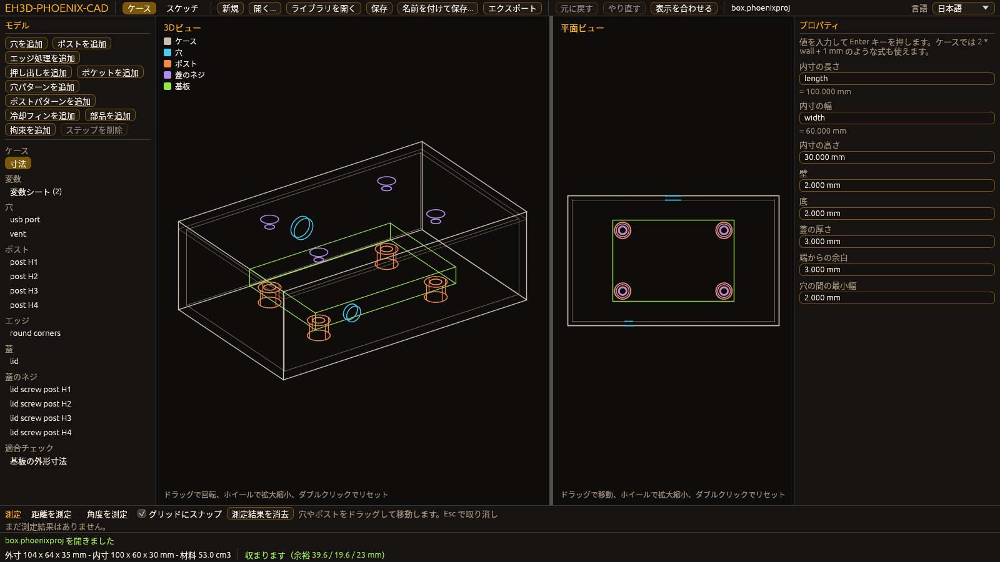
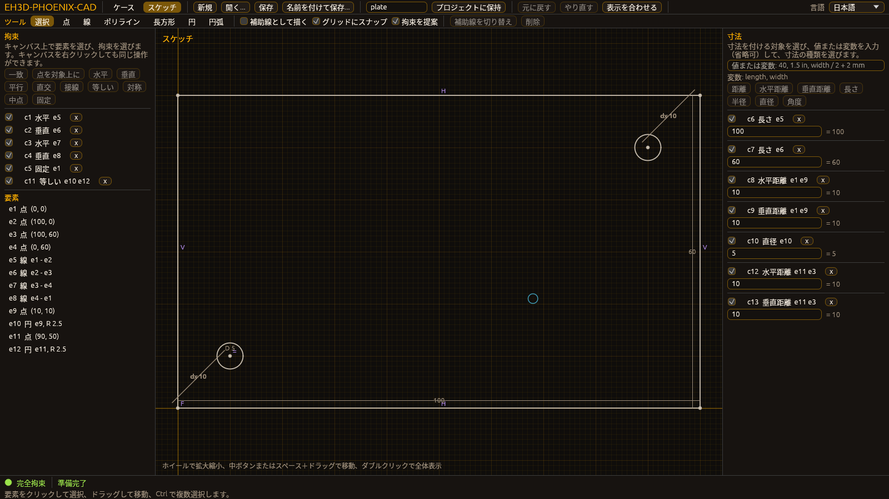

<p align="center">
  
</p>

#  EH3D-PHOENIX-CAD
<p align="center"><a href="README.md">🇺🇸 English</a> | <a href="README_spa.md">🇪🇸 Español</a> | <a href="README_fra.md">🇫🇷 Français</a> | <a href="README_ita.md">🇮🇹 Italiano</a> | <a href="README_deu.md">🇩🇪 Deutsch</a> | <a href="README_zho.md">🇨🇳 中文</a> | 🇯🇵 <b>日本語</b> | <a href="README_por.md">🇵🇹 Português</a></p>

### EH3D-PHOENIX-CAD：筐体、シャーシ、ヒートシンクの設計に特化したパラメトリック機械 CADとして計画中。筐体の最初のモデルがライブラリとして存在し、画面で一度も開かれていないウィンドウが付いていますが、機械ではまだ何も実行していません。

<p align="center">
  
  
  
  
  
  
</p>

---

**正直さの確認 - 今日実際に動くもの：** Rust ライブラリで、パラメトリックな筐体を扱います（独自の範囲を持つ整数ナノメートルの長さ、面の穴（丸穴、皿穴、座ぐり穴、角穴、長穴）、丸めた縁と面取りした縁、変数・定数・他のパラメータに対する単位付きの式で書けるパラメータ（厳密な分数、検査付きのオーバーフロー）、衝突を報告してモデルを変えない構造化された変更操作、基板の取り付け穴の下に立てる支柱とそこにねじ止めする蓋、プロジェクトファイルの機構ドメインに保存した筐体のレシピ、OpenSCAD 形式のスクリプト、基板の外形に対する収まりの検査）。ウィンドウ（egui、`--features gui` でビルド）がモデルのツリー、各項目のプロパティ、3D ビュー、平面ビューを表示し（穴やポストをマウスでドラッグし、距離や角度を測定できます。スクリプト、STEP ファイル、適合レポートはメニューからファイルに書き出せ、専用のチェックボックスを入れない限り既存のファイルには上書きしません）、`check` コマンドはプロジェクトを読んで寸法、収まり、各手順の状態を表示します。ウィンドウのロジックは画面なしでテストされています。独自のテストが 706 件あり、コンピューター上で通っています。試したのは自身のテストが作ったモデルだけで、ウィンドウを画面で開いたことも機械での実行もなく、書き出す STEP ファイルは構造だけを確認しており、2D スケッチ（形状、拘束、ソルバー、描画と寸法付けのためのウィンドウ）はプロジェクトファイルに保存され、その閉じた輪郭は面から押し出したり面に切り込んだりでき、レシピの手順になりますが、自身のテストが作ったスケッチでしか試しておらず、そのウィンドウもまだ画面で開いたことがなく、穴とポストのパターンおよび冷却フィン（静止空気への放熱量の簡易推定つきで、実測とは比較していません）はありますが、自身のテストが作ったモデルでしか試しておらず、カタログの部品（長さに切断したプロファイル、ライブラリファイルから読み込んでモデルに配置したネジとブラケット。部品表、切断リスト、材料ごとの密度による体積と質量つき。例のライブラリは架空のものです）も同様で、これらの部品の簡易アセンブリ（ある部品を別の部品に対して 1 つの軸に沿って間隔・整列・積み重ねで配置し、プロファイル・ブラケット・ネジの正確な形状で体積を共有する部品を調べ、ブラケットの穴を通るネジは許容します。例の 2 つのアセンブリは架空のものです）も同様です。モデルのソリッドは STL ファイル（バイナリまたはテキスト。閉じた表面を正確な体積と照合し、作れない形状は拒否します）として、平面・正面・側面は DXF と SVG の図面として、エクスポートメニューまたは `export` コマンドで書き出せます。これらのファイルはスライサー、CAD、作図ソフトで開いたことはありません。

---

> **安全性とセキュリティの現状：** このリポジトリは最初の段階で、安全装置ではありません。ここに書かれたことが、機械とそのコントローラーの上限、インターロック、非常停止の代わりになることはありません。

## 📋 ひと目で

| | |
|---|---|
| バージョン | `0.0.6` |
| 成熟度 | 足場 |
| テスト | 709 |
| 技術スタック | Rust, Markdown, Python 3.10+ |
| 実機での動作 | まだハードウェアでは実行していません |

**移動先：** [概要](#-概要) · [アーキテクチャ](#-アーキテクチャ) · [クイックスタート](#-クイックスタート) · [テスト](#-テスト) · [リポジトリの構成](#-リポジトリの構成) · [関連プロジェクト](#-関連プロジェクト)

## 🚦 プロジェクトの状況

各行はこのリポジトリの一部分で、信号は今日どこまで進んでいるかを示します。計画ではなく、リポジトリが示せるもの（テスト、ビルド、実行）に基づいて書かれています。

🟢 完了・検証済み · 🟡 動作する（既知の制限あり） · 🟠 一部のみ、または未検証 · 🔴 未実装または動作しない

| 領域 | 状態 | ここでの意味 |
|---|---|---|
| リポジトリ チェック | 🟡 | リポジトリ チェック、画像のチェック、基盤の 3 件のテストは CI で実行され、通っています。 |
| テスト | 🟡 | Rust ライブラリの 706 件と基盤の 3 件のテストがコンピューター上で通っています。使うのはテスト自身が作ったモデルだけです。 |
| 実機 | 🟠 | どの機械やボードでも実行していません。ここにあるものは、ハードウェア上で試していません。 |
| 計画中の機能 | 🟠 | 一部完了：穴・支柱・ねじ止めの蓋を持つパラメトリックな筐体、OpenSCAD 形式のスクリプト、収まりの検査、プロジェクトファイル内の筐体のレシピと、構造だけを確認した最初の STEP 書き出しがあります。拘束、ソルバー、描画用ウィンドウを持つ 2D スケッチがあり、プロジェクトファイルに保存され、面から押し出したり面に切り込んだりできますが、そのウィンドウはまだ画面で開いたことがなく、穴とポストのパターンと、放熱量の推定つきの冷却フィンがありますが、テストが作ったモデルでしか試していません。ライブラリファイルのカタログ部品（プロファイル、ネジ、ブラケット）をモデルに配置し、部品表と材料ごとの質量を出す機能がありますが、架空の部品でしか試していません。これらの部品の簡易アセンブリ（ある部品を別の部品に対して 1 つの軸に沿って配置する機能と、体積を共有する部品を調べる機能）がありますが、架空の部品でしか試していません。 |
| 要件 | 🟠 | 8 件の要件のうち 7 件がプロトタイプ（筐体、スクリプト、変更操作、ヒートシンクのモデル、部品カタログ、アセンブリ、機械用の範囲）、1 件は計画のみで、検証済みのものはありません。 |

## 🎯 概要

* **計画中：** EH3D-PHOENIX-CAD は、筐体、シャーシ、ヒートシンクの設計に特化したパラメトリック機械 CAD を目指し、ウィンドウ付きのライブラリ、コマンドラインインターフェース、必要に応じてサーバータスクの形をとります。ライブラリは最初のパラメトリック筐体、ツリー・プロパティ・3D ビュー・平面ビューを表示し、穴やポストをマウスでドラッグして距離や角度を測定できるウィンドウ（画面で一度も開かれていません）、`check` コマンドとともに存在しますが、サーバータスクはまだなく、冷却フィン（放熱量の推定つき）は STEP ファイルに含まれず、STEP ファイルは構造だけを確認しています。

## 🧩 EH3D での役割

EH3D-PHOENIX-CAD は EH3D Fabrication Suite の PHOENIX ファミリーの一部です。何をするか、まだ何をしないか、要件、他のリポジトリとの関係は `docs/` フォルダーに書かれています。

<p align="center">
  
  
</p>

## 🏛️ アーキテクチャ

<p align="center">
  
</p>

このリポジトリの各部分の関係：誰が使い、何を持ち、何に依存するか。図は `docs/architecture.json` から描かれ、コードと照合されます。

## 🚀 クイックスタート

Python 3.10 以降が必要で、インストールするものはありません。

```bash
python -I tools/ci_validate.py
python -I tools/make_architecture.py --check
python -I tools/make_structure.py --check --readmes
python -I -m unittest discover -s tools -p "test_*.py"
```

プログラムを試すには（Rust が必要。ウィンドウには `--features gui` が必要）：

```bash
cargo run -p eh3d-phoenix-cad -- check crates/eh3d-phoenix-cad/examples/box.phoenixproj
cargo run -p eh3d-phoenix-cad -- check crates/eh3d-phoenix-cad/examples/plate.phoenixproj
cargo run -p eh3d-phoenix-cad -- check crates/eh3d-phoenix-cad/examples/frame.phoenixproj
cargo run -p eh3d-phoenix-cad -- bill crates/eh3d-phoenix-cad/examples/frame.phoenixproj
cargo run -p eh3d-phoenix-cad -- library crates/eh3d-phoenix-cad/examples/chassis.phoenixlib
cargo run -p eh3d-phoenix-cad -- check crates/eh3d-phoenix-cad/examples/assembly.phoenixproj
cargo run -p eh3d-phoenix-cad -- interference crates/eh3d-phoenix-cad/examples/assembly.phoenixproj
cargo run -p eh3d-phoenix-cad -- export crates/eh3d-phoenix-cad/examples/box.phoenixproj --format stl --out box.stl
cargo run -p eh3d-phoenix-cad -- export crates/eh3d-phoenix-cad/examples/box.phoenixproj --format svg --view front --out box-front.svg
cargo run --release -p eh3d-phoenix-cad --features gui -- crates/eh3d-phoenix-cad/examples/box.phoenixproj
cargo run --release -p eh3d-phoenix-cad --features gui -- gui crates/eh3d-phoenix-cad/examples/box.phoenixproj --shot box.png
cargo run --release -p eh3d-phoenix-cad --features gui -- gui crates/eh3d-phoenix-cad/examples/box.phoenixsketch --view sketch --shot sketch.png
```

## 🧪 テスト

Rust ライブラリには 706 件のテスト（`cargo test`）、基盤には 3 件のテスト（`python -I -m unittest discover -s tools -p "test_*.py"`）があり、すべてコンピューター上で通っています。CI はリポジトリ チェック、画像のチェック、基盤のテストを実行し、Rust のコードについては書式チェック、警告をエラーとする clippy、Linux と Windows でのテストを実行し、ウィンドウも clippy（`--features gui`）で検査します。

## 🏗️ ビルドとリリース

バージョンは `VERSION` ファイルと `eh3d.project.json` にあり、各バージョンには [CHANGELOG.md](CHANGELOG.md) の項目があります。プログラムは `cargo build --release` でビルドし（ウィンドウは `--features gui` 付き）、リリースは GitHub で公開されます。

## 📂 リポジトリの構成

<p align="center">
  
</p>

<details>
<summary>ツリーのテキスト版</summary>

```text
EH3D-PHOENIX-CAD/
├── docs/
│   ├── architecture.json structure.json         2 つの図のデータ
│   ├── SCOPE.md REQUIREMENTS.md                 計画内容とその要件
│   ├── DEPENDENCIES.md THREAT_MODEL.md          他のリポジトリとの関係と脅威モデル
│   ├── DECISIONS.md STATUS.md                   適用される決定事項と正直な状況
│   ├── NOT_YET.md RULES.md                      後回しにしたアイデアとコードの記述規則
│   ├── ERROR_CODES.md                           診断コード PHOENIX-<領域>-<NNN>
│   ├── EXPRESSIONS.md                           パラメータの式の言語
│   ├── PROJECT_DOMAIN.md                        プロジェクトファイル内の筐体のレシピ
│   ├── SKETCH.md                                2D スケッチ：拘束、ソルバー、プロジェクトファイル、押し出し
│   ├── CATALOG.md                               部品カタログ：ライブラリ、部品表、切断リスト
│   ├── ASSEMBLY.md                              簡易アセンブリ：拘束と干渉の検査
│   ├── EXPORT.md                                エクスポート：STL ソリッド、DXF と SVG の図面
│   └── adr/                                     承認された決定の記録
├── Cargo.toml Cargo.lock                        Rust ワークスペースと固定された依存関係
├── crates/                                      機械モデル：筐体、パターン、冷却フィン、部品、アセンブリ、スケッチ、スクリプト、ウィンドウ
├── AGENTS.md                                    リポジトリを変更する人のための規則
├── tools/                                       リポジトリ チェック、そのテスト、画像のツール
├── images/                                      バナーとアーキテクチャ・リポジトリ構成の図
├── .github/                                     CI とダッシュボードのワークフロー、Issue と PR のテンプレート
├── eh3d.project.json                            マニフェスト：バージョン、役割、成熟度、ビルドコマンド
├── VERSION                                      リポジトリのバージョン
├── CHANGELOG.md                                 各バージョンの変更点
├── SECURITY.md SUPPORT.md                       脆弱性の報告方法と問い合わせ先
└── CONTRIBUTING.md CODE_OF_CONDUCT.md LICENSE   貢献方法、行動規範、ライセンス
```

</details>

## 🗺️ ロードマップと既知の制限

**現時点で分かっている制限**

* 初期段階のコード：あるのは筐体のモデルとそのスケッチ・押し出し・ポケットで、自身のテストが作ったモデルでしか試していません。機械では何も実行しておらず、検証済みの要件はありません。

**次のステップ**

* 基板ツールにプロジェクト形式の機械ドメインを読み書きさせ、STEP ファイルを CAD プログラムで開き、そのあとに 1 つの軸に沿った拘束を超えてアセンブリを拡張し、冷却フィンの推定を実測と比較する。いずれもテストとともに行う。

## 🌍 言語

README とテキストは、英語、スペイン語、フランス語、イタリア語、ドイツ語、中国語、日本語、ヨーロッパポルトガル語で提供されています。

## 🔗 関連プロジェクト

* [EH3D-DOCS](https://github.com/JuanenRac/EH3D-DOCS)：スイートの地図、アーキテクチャ、規約、共有チェック
* [EH3D-COMMON](https://github.com/JuanenRac/EH3D-COMMON)：穴が使うオブジェクト識別子（UUID v7）。今後はプロジェクトコンテナと診断クレートも
* 計画中の関係（未構築）（EH3D-PHOENIX-PCB, EH3D-THERMAL-LAB）：[docs/DEPENDENCIES.md](docs/DEPENDENCIES.md) を参照

## 📚 ドキュメント

* [スイートの規約](https://github.com/JuanenRac/EH3D-DOCS/blob/main/docs/CONVENTIONS.md)
* [変更履歴](CHANGELOG.md)
* [範囲、要件、依存関係、脅威モデル、決定事項](docs/SCOPE.md)

## 🤝 コントリビュートとコミュニティ

* プル リクエストの前に `python -I tools/ci_validate.py` と基盤のテストを実行してください。すべて通る必要があります。[CONTRIBUTING.md](CONTRIBUTING.md) と[行動規範](CODE_OF_CONDUCT.md)を参照してください。
* README は 8 言語あります。文章を変更するときは 8 つのファイルすべてを変更し、2 つの図は `docs/architecture.json` と `docs/structure.json` から `tools/make_architecture.py` と `tools/make_structure.py` で描画します。
* 脆弱性は非公開で報告してください：[SECURITY.md](SECURITY.md)。質問、アイデア、報告：electrohobby3d@gmail.com（[SUPPORT.md](SUPPORT.md)）。

## 👤 作者

**JuanenRac (Electro Hobby 3D)** · electrohobby3d@gmail.com

## 📜 ライセンス

ソフトウェア：GPL-3.0-or-later。[LICENSE](LICENSE) を参照。スイートのハードウェア設計には CERN OHL-S を使います。
