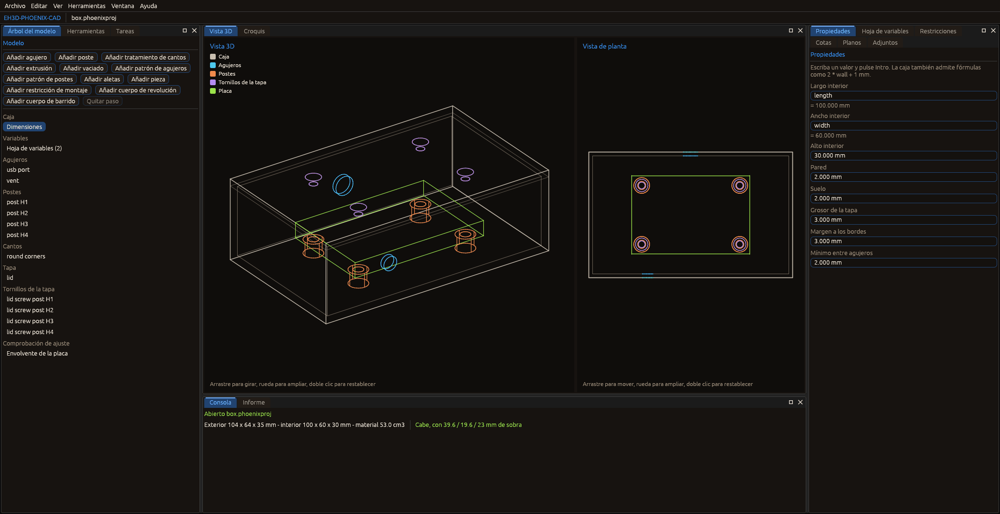
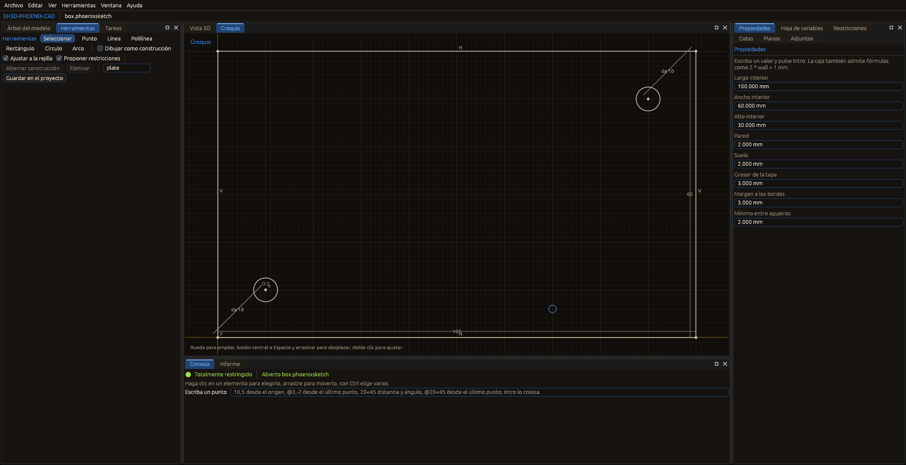
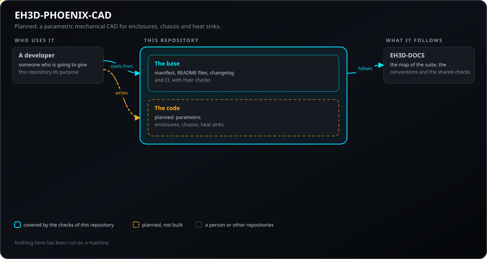
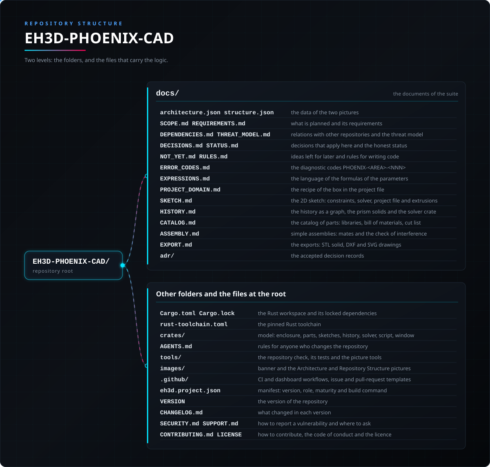

<p align="center">
  
</p>

#  EH3D-PHOENIX-CAD
<p align="center"><a href="README.md">🇺🇸 English</a> | 🇪🇸 <b>Español</b> | <a href="README_fra.md">🇫🇷 Français</a> | <a href="README_ita.md">🇮🇹 Italiano</a> | <a href="README_deu.md">🇩🇪 Deutsch</a> | <a href="README_zho.md">🇨🇳 中文</a> | <a href="README_jpn.md">🇯🇵 日本語</a> | <a href="README_por.md">🇵🇹 Português</a></p>

### EH3D-PHOENIX-CAD: planificado como un CAD mecánico paramétrico centrado en el diseño de cajas, chasis y disipadores térmicos. Existe un primer modelo de cajas como biblioteca con una ventana que nunca se ha abierto en una pantalla; no se ha ejecutado nada en una máquina.

<p align="center">
  
  
  
  
  
  
</p>

---

**Comprobación de honestidad - lo que se ejecuta hoy:** una biblioteca de Rust con una caja paramétrica: longitudes en nanómetros enteros con su propio rango, agujeros en las caras (redondos, avellanados, cajeados, rectangulares y ovalados), aristas redondeadas y achaflanadas, parámetros que son fórmulas con unidades sobre variables, constantes y otros parámetros (fracciones exactas, desbordamiento comprobado), operaciones de cambio estructuradas que informan de los conflictos y dejan el modelo intacto, postes bajo los agujeros de montaje de una placa con una tapa atornillada a ellos, la receta de la caja guardada en el dominio mecánico del archivo de proyecto, un script al estilo OpenSCAD y una comprobación de encaje contra la envolvente de una placa. Una ventana (egui, con `--features gui`) muestra el árbol del modelo, las propiedades de cada elemento, una vista 3D y una planta (donde se arrastran agujeros y postes con el ratón y se miden distancias y ángulos; el script, el fichero STEP y el informe de ajuste se escriben en un fichero desde un menú, nunca sobre un fichero que existe salvo que se marque la casilla para ello; un menú Informes muestra el plan de corte, la tabla de agujeros, la holgura entre piezas, las posiciones, la masa y el centro de masa y el dibujo de un croquis como texto en los ocho idiomas), y un comando `check` lee un proyecto e imprime sus medidas, su encaje y el estado de cada paso; la lógica de la ventana se prueba sin pantalla. Tiene 1746 pruebas propias y pasan en un ordenador. Solo se ha probado con modelos hechos por sus propias pruebas; la ventana nunca se ha abierto en una pantalla y no se ha ejecutado nada en una máquina, y el fichero STEP que escribe solo se ha comprobado en su estructura, y el croquis 2D (geometría, restricciones, un solucionador y una ventana para dibujarlo y acotarlo), que se guarda en el archivo de proyecto y cuyos contornos cerrados se pueden extruir desde una cara o vaciar en ella como pasos de la receta, solo se ha probado con croquis hechos por sus propias pruebas y su ventana todavía no se ha abierto en una pantalla, mientras que los patrones de agujeros y postes y las aletas de refrigeración (con una estimación sencilla del calor que ceden al aire en calma, comparada con ninguna medición) existen pero solo se han probado con modelos hechos por sus propias pruebas, y lo mismo ocurre con las piezas de un catálogo (perfiles cortados a una longitud, tornillos y escuadras leídos de ficheros de biblioteca y colocados en el modelo, con una lista de materiales, una lista de corte y el volumen y la masa según la densidad de cada material; la biblioteca de los ejemplos es inventada), y lo mismo ocurre con los ensamblajes simples de esas piezas (una pieza colocada contra otra a lo largo de un eje con una separación, una alineación o un apilado, y una comprobación de qué piezas comparten volumen con las formas exactas de perfiles, escuadras y tornillos, permitiendo un tornillo a través del agujero de una escuadra; los dos ensamblajes de ejemplo son inventados). El sólido del modelo se puede escribir como fichero STL (binario o de texto, con la superficie cerrada comprobada contra el volumen exacto; algunas formas se rechazan) y la planta, el alzado y el perfil como dibujos DXF y SVG, desde el menú Exportar o con la orden `export`; ninguno de estos ficheros se ha abierto en un programa de corte, de CAD ni de dibujo. Los ficheros STEP de sólidos hechos de caras planas se pueden leer (el perfil de un boceto elevado a prisma se escribe como uno), la masa y la inercia de lo leído se calculan a partir de sus triángulos, y un dibujo DXF de la caja puede llevar la hoja de un tamaño de papel a una escala normalizada; ningún programa de CAD ha abierto estos ficheros. Desde la línea de órdenes se puede comprobar una malla para imprimirla (envolventes, género, aristas abiertas, superficies del revés, radios de giro), soldarla y darle la vuelta; se pueden convertir valores y ángulos (pulgadas en fracciones, grados-minutos-segundos), listar círculos de agujeros, repartir el coste de una lista con un impuesto, medir puntos, comparar la configuración con los valores por defecto, resumir croquis y empezar proyectos nuevos desde plantillas; nada de esto se ha probado en una máquina. Se pueden leer y escribir archivos de otros programas (paquetes 3MF comprimidos, STL tolerante, PLY, OFF, caras DXF, STEP facetado y dibujos SVG), convertir, escalar, girar, reflejar y repetir sólidos en patrones, cortarlos con un plano o una caja y seccionarlos, y calcular límites y ajustes ISO 286 desde una tabla no verificada; nada de esto se ha probado con archivos de otros programas ni en una máquina. El historial de un diseño es un grafo de dependencias (parámetros con fórmulas y unidades, operaciones con cajas alineadas con los ejes y booleanas exactas, una reconstrucción que solo hace lo que toca una edición, un error con código para cada nodo y el comando `history-check`), el motor numérico del solucionador de croquis es un crate propio, y la ventana se organiza con el marco de paneles de la suite (paneles que se pueden quitar, poner, mover, flotar y plegar, espacios de trabajo y una barra de menús); solo se ha probado con historiales hechos por sus propios tests y la ventana nunca se ha abierto en una pantalla. Las hojas de plano 2D (vistas de los sólidos del historial con aristas visibles y ocultas, cotas ligadas por identificadores a los nodos del historial y a los croquis que siguen una edición y señalan las huérfanas, capas, globos ligados a la lista de materiales derivada del historial con números de elemento que no cambian, secciones con rayado y detalles, tolerancias ISO 286, cotas en cadena y ordenadas, una tabla de revisiones, un cajetín, vistas rotas, notas con línea de referencia, atributos libres de las piezas, archivos SVG, PDF y DXF, los comandos `drawing-check` y `drawing-export` y un panel de la ventana) solo se han probado con sólidos y croquis hechos por sus propios tests, y ningún archivo se ha abierto en un programa de dibujo. Un proyecto puede vivir además en la rama `cad` de un único fichero `.eh3d` de la suite, donde cada programa guarda su propia rama: este programa hace una caja alrededor de la placa que describe la rama `pcb`, avisa cuando la placa ha cambiado, mueve los postes con sus agujeros, comprueba que las huellas de los componentes caben, abre los huecos de los conectores y devuelve el STL, las caras planas y los postes; lo completan los selectores sobre los nombres estables y una tabla de los parámetros frente a sus límites. El programa de placas todavía no escribe esa descripción, así que solo se ha probado con placas inventadas por las pruebas. El menú Archivo de la ventana abre, guarda y lista las ramas de ese fichero, conserva el original de una importación y toma la placa para la caja, y la orden `sketch-check` señala lo que está mal o casi bien en un fichero de croquis; nada de esto se ha visto en una pantalla ni se ha probado en un diseño real. Un proyecto puede guardar variantes (valores con nombre de sus variables) que se aplican, se comprueban y se exportan en un archivo cada una, una cota de un croquis puede ser de referencia (se lee y no fija nada), y la ventana edita el título y la descripción de un proyecto `.eh3d` y comprueba las firmas de sus ramas con claves públicas de confianza; esto solo lo han probado las pruebas y las ventanas nuevas no se han visto en pantalla.

---

> **Estado de seguridad (safety) y de seguridad informática:** este repositorio está en sus primeros pasos y no es un sistema de seguridad (safety). Nada de lo escrito aquí sustituye los límites, los enclavamientos y la parada de emergencia de la máquina y de su controlador.

## 📋 De un vistazo

| | |
|---|---|
| Versión | `0.1.4` |
| Madurez | Andamiaje |
| Pruebas | 1746 |
| Pila tecnológica | Rust, Markdown, Python 3.10+ |
| En hardware real | Aún no se ha ejecutado en hardware |

**Ir a:** [Resumen](#-resumen) · [Arquitectura](#-arquitectura) · [Inicio rápido](#-inicio-rápido) · [Pruebas](#-pruebas) · [Estructura del repositorio](#-estructura-del-repositorio) · [Proyectos relacionados](#-proyectos-relacionados)

## 🚦 Estado del proyecto

Cada línea es una parte de este repositorio y la luz dice hasta dónde llega hoy. Se escribe con lo que el repositorio puede demostrar (pruebas, compilaciones, ejecuciones), no con lo previsto.

🟢 Hecho y verificado · 🟡 Funciona, con límites conocidos · 🟠 Hecho a medias o sin verificar · 🔴 Sin hacer o sin funcionar

| Área | Estado | Qué significa aquí |
|---|---|---|
| Comprobaciones del repositorio | 🟡 | La comprobación del repositorio, la de las imágenes y las 4 pruebas de la base se ejecutan en el CI y pasan. |
| Pruebas | 🟡 | Las 1746 pruebas de la biblioteca de Rust y las 4 de la base pasan en un ordenador. Solo usan modelos hechos por las propias pruebas. |
| Hardware real | 🟠 | No se ha ejecutado en ninguna máquina ni placa: nada de aquí se ha probado en hardware. |
| Función planificada | 🟠 | Hecho en parte: existen una caja paramétrica con agujeros, postes y una tapa atornillada, un script al estilo OpenSCAD, una comprobación de encaje y la receta de la caja en el archivo de proyecto, y hay un primer escritor de STEP comprobado solo en su estructura; existe un croquis 2D con restricciones, un solucionador y una ventana para dibujarlo, que se guarda en el archivo de proyecto y se puede extruir desde una cara o vaciar en ella, pero su ventana todavía no se ha abierto en una pantalla; existen patrones de agujeros y postes y aletas de refrigeración con una estimación de su calor, probados solo con modelos hechos por las pruebas; existen las piezas de un catálogo (perfiles, tornillos y escuadras de ficheros de biblioteca) colocadas en el modelo con lista de materiales y la masa de cada material, probadas solo con piezas inventadas; existen ensamblajes simples de esas piezas (una pieza colocada contra otra a lo largo de un eje y una comprobación de qué piezas comparten volumen), probados solo con piezas inventadas. Existen hojas de plano 2D con vistas, cotas que siguen al modelo, capas y globos ligados a la lista, probadas solo con sólidos hechos por las pruebas. |
| Requisitos | 🟠 | 34 de 35 requisitos están en prototipo (FCAD-001 y de FCAD-003 a FCAD-035, véase docs/REQUIREMENTS.md), 1 solo está planificado y ninguno está validado. |

## 🎯 Resumen

* **Planificado:** EH3D-PHOENIX-CAD quiere ser un CAD mecánico paramétrico centrado en el diseño de cajas, chasis y disipadores, como una biblioteca con ventana, con una interfaz de línea de comandos y, cuando proceda, un tipo de tarea del servidor. La biblioteca existe con una primera caja paramétrica, una ventana que muestra su árbol, sus propiedades, una vista 3D y una planta, donde se arrastran agujeros y postes con el ratón y se miden distancias y ángulos (todavía sin abrir en una pantalla) y un comando `check`; la tarea del servidor todavía no existe, las aletas de refrigeración (con una estimación de su calor) no están en el fichero STEP, y el fichero STEP solo se ha comprobado en su estructura.

## 🧩 Papel en EH3D

EH3D-PHOENIX-CAD forma parte de la familia PHOENIX de la EH3D Fabrication Suite. Lo que hará, lo que todavía no hará, sus requisitos y sus relaciones con otros repositorios están escritos en la carpeta `docs/`.

<p align="center">
  
  
</p>

## 🏛️ Arquitectura

<p align="center">
  
</p>

Cómo encajan las partes de este repositorio: quién lo usa, qué contiene y de qué depende. La imagen se dibuja desde `docs/architecture.json` y se comprueba contra el código.

## 🚀 Inicio rápido

Necesitas Python 3.10 o posterior; no hay nada que instalar.

```bash
python -I tools/ci_validate.py
python -I tools/make_architecture.py --check
python -I tools/make_structure.py --check --readmes
python -I -m unittest discover -s tools -p "test_*.py"
```

Para probar el programa (necesita Rust; la ventana necesita `--features gui`):

```bash
cargo run -p eh3d-phoenix-cad -- check crates/eh3d-phoenix-cad/examples/box.phoenixproj
cargo run -p eh3d-phoenix-cad -- eh3d-save crates/eh3d-phoenix-cad/examples/box.phoenixproj job.eh3d
cargo run -p eh3d-phoenix-cad -- eh3d-info job.eh3d
cargo run -p eh3d-phoenix-cad -- variants job.eh3d --check --text
cargo run -p eh3d-phoenix-cad -- select job.eh3d "edges|Z"
cargo run -p eh3d-phoenix-cad -- params job.eh3d --text
cargo run -p eh3d-phoenix-cad -- panels job.eh3d faces.svg
cargo run -p eh3d-phoenix-cad -- check crates/eh3d-phoenix-cad/examples/plate.phoenixproj
cargo run -p eh3d-phoenix-cad -- check crates/eh3d-phoenix-cad/examples/frame.phoenixproj
cargo run -p eh3d-phoenix-cad -- bill crates/eh3d-phoenix-cad/examples/frame.phoenixproj
cargo run -p eh3d-phoenix-cad -- library crates/eh3d-phoenix-cad/examples/chassis.phoenixlib
cargo run -p eh3d-phoenix-cad -- check crates/eh3d-phoenix-cad/examples/assembly.phoenixproj
cargo run -p eh3d-phoenix-cad -- interference crates/eh3d-phoenix-cad/examples/assembly.phoenixproj
cargo run -p eh3d-phoenix-cad -- balance crates/eh3d-phoenix-cad/examples/frame.phoenixproj
cargo run -p eh3d-phoenix-cad -- sketch-export crates/eh3d-phoenix-cad/examples/box.phoenixsketch --format dxf --out box-sketch.dxf
cargo run -p eh3d-phoenix-cad -- holes crates/eh3d-phoenix-cad/examples/box.phoenixproj --tools
cargo run -p eh3d-phoenix-cad -- placements crates/eh3d-phoenix-cad/examples/assembly.phoenixproj --explode 50
cargo run -p eh3d-phoenix-cad -- clearance crates/eh3d-phoenix-cad/examples/assembly.phoenixproj
cargo run -p eh3d-phoenix-cad -- cutplan crates/eh3d-phoenix-cad/examples/frame.phoenixproj --text
cargo run -p eh3d-phoenix-cad -- holes crates/eh3d-phoenix-cad/examples/box.phoenixproj --text --lang es
cargo run -p eh3d-phoenix-cad -- balance crates/eh3d-phoenix-cad/examples/frame.phoenixproj --lang de
cargo run -p eh3d-phoenix-cad -- revolve crates/eh3d-phoenix-cad/examples/plate.phoenixproj --axis y --angle 90 --material PLA
cargo run -p eh3d-phoenix-cad -- export crates/eh3d-phoenix-cad/examples/box.phoenixproj --format stl --out box.stl
cargo run -p eh3d-phoenix-cad -- export crates/eh3d-phoenix-cad/examples/box.phoenixproj --format svg --view front --out box-front.svg
cargo run --release -p eh3d-phoenix-cad --features gui -- crates/eh3d-phoenix-cad/examples/box.phoenixproj
cargo run --release -p eh3d-phoenix-cad --features gui -- gui crates/eh3d-phoenix-cad/examples/box.phoenixproj --shot box.png
cargo run --release -p eh3d-phoenix-cad --features gui -- gui crates/eh3d-phoenix-cad/examples/box.phoenixsketch --view sketch --shot sketch.png
```

## 🧪 Pruebas

La biblioteca de Rust tiene 1746 pruebas (`cargo test`) y la base tiene 4 (`python -I -m unittest discover -s tools -p "test_*.py"`); todas pasan en un ordenador. El CI ejecuta la comprobación del repositorio, la de las imágenes, las pruebas de la base y, para el código de Rust, la comprobación de formato, clippy con advertencias como errores y las pruebas en Linux y Windows, y además revisa la ventana con clippy (`--features gui`). La cifra anterior cuenta también los ejemplos de la documentación, y el CI falla cuando los README dicen otra.

## 🏗️ Compilación y publicación

La versión vive en el fichero `VERSION` y en `eh3d.project.json`, y cada versión tiene su entrada en [CHANGELOG.md](CHANGELOG.md). El programa se compila con `cargo build --release` (la ventana con `--features gui`); las versiones se publican en GitHub.

## 📂 Estructura del repositorio

<p align="center">
  
</p>

<details>
<summary>Versión en texto del árbol</summary>

```text
EH3D-PHOENIX-CAD/
├── docs/
│   ├── architecture.json structure.json         los datos de las dos imágenes
│   ├── SCOPE.md REQUIREMENTS.md                 lo planificado y sus requisitos
│   ├── DEPENDENCIES.md THREAT_MODEL.md          relaciones con otros repositorios y modelo de amenazas
│   ├── DECISIONS.md STATUS.md                   decisiones que se aplican aquí y estado honesto
│   ├── NOT_YET.md RULES.md                      ideas para más adelante y reglas para escribir código
│   ├── ERROR_CODES.md                           los códigos de diagnóstico PHOENIX-<ÁREA>-<NNN>
│   ├── EXPRESSIONS.md                           el lenguaje de las fórmulas de los parámetros
│   ├── PROJECT_DOMAIN.md                        la receta de la caja en el archivo de proyecto
│   ├── SKETCH.md                                el croquis 2D: restricciones, solucionador, archivo de proyecto y extrusiones
│   ├── HISTORY.md                               el historial como grafo, los sólidos de prismas y el crate del solucionador
│   ├── DRAWING.md                               las hojas de plano: vistas, cotas, globos y capas
│   ├── CATALOG.md                               el catálogo de piezas: bibliotecas, lista de materiales y de corte
│   ├── ASSEMBLY.md                              ensamblajes simples: restricciones e interferencias
│   ├── BOARD_INTERCHANGE.md                     la placa y la caja en un fichero .eh3d
│   ├── EXPORT.md                                las exportaciones: sólido STL, dibujos DXF y SVG
│   └── adr/                                     los registros de decisiones aceptadas
├── Cargo.toml Cargo.lock                        el espacio de trabajo de Rust y sus dependencias fijadas
├── rust-toolchain.toml                          la toolchain de Rust fijada
├── crates/                                      modelo: caja, piezas, croquis, historial, solucionador, script, ventana
├── AGENTS.md                                    reglas para quien cambia el repositorio
├── tools/                                       la comprobación del repositorio, sus pruebas y las herramientas de las imágenes
├── images/                                      banner y las imágenes de Arquitectura y Estructura del repositorio
├── .github/                                     flujos de CI y del panel, plantillas de issues y pull requests
├── eh3d.project.json                            manifiesto: versión, rol, madurez y comando de compilación
├── VERSION                                      la versión del repositorio
├── CHANGELOG.md                                 qué cambió en cada versión
├── SECURITY.md SUPPORT.md                       cómo informar de una vulnerabilidad y dónde preguntar
└── CONTRIBUTING.md CODE_OF_CONDUCT.md LICENSE   cómo contribuir, el código de conducta y la licencia
```

</details>

## 🗺️ Hoja de ruta y límites conocidos

**Límites conocidos hoy**

* Código inicial: el modelo de una caja con sus croquis, extrusiones y vaciados, probado con modelos hechos por sus propias pruebas; no se ha ejecutado nada en una máquina y ningún requisito está validado.

**Siguiente**

* Hacer que la herramienta de placas lea y escriba el dominio mecánico del formato de proyecto, abrir el fichero STEP en un programa de CAD y después ampliar los ensamblajes más allá de las restricciones a lo largo de un eje y comparar la estimación de las aletas de refrigeración con una medición, cada uno con sus pruebas.

## 🌍 Idiomas

El README y los textos existen en inglés, español, francés, italiano, alemán, chino, japonés y portugués de Portugal.

## 🔗 Proyectos relacionados

* [EH3D-DOCS](https://github.com/JuanenRac/EH3D-DOCS): el mapa de la suite, su arquitectura, las convenciones y las comprobaciones compartidas
* [EH3D-COMMON](https://github.com/JuanenRac/EH3D-COMMON): la identidad de objeto (UUID v7) que usan los agujeros; más adelante el contenedor de proyecto y la crate de diagnóstico
* Relaciones planificadas, aún sin construir (EH3D-PHOENIX-PCB, EH3D-THERMAL-LAB): véase [docs/DEPENDENCIES.md](docs/DEPENDENCIES.md)

## 📚 Documentación

* [Las convenciones de la suite](https://github.com/JuanenRac/EH3D-DOCS/blob/main/docs/CONVENTIONS.md)
* [Registro de cambios](CHANGELOG.md)
* [Alcance, requisitos, dependencias, modelo de amenazas y decisiones](docs/SCOPE.md)
* [El enlace con el servidor EH3D: proyectos e informes guardados en él](docs/SERVER.md)
* [La placa y la caja en un proyecto de la suite (`.eh3d`)](docs/BOARD_INTERCHANGE.md)

## 🤝 Contribuir y comunidad

* Antes de una pull request ejecuta `python -I tools/ci_validate.py` y las pruebas de la base: todo debe pasar. Consulta [CONTRIBUTING.md](CONTRIBUTING.md) y el [código de conducta](CODE_OF_CONDUCT.md).
* El README existe en ocho idiomas: un cambio en el texto se hace en los ocho archivos, y las dos imágenes se dibujan a partir de `docs/architecture.json` y `docs/structure.json` con `tools/make_architecture.py` y `tools/make_structure.py`.
* Informa de una vulnerabilidad en privado: [SECURITY.md](SECURITY.md). Preguntas, ideas e informes: electrohobby3d@gmail.com ([SUPPORT.md](SUPPORT.md)).

## 👤 AUTOR

**JuanenRac (Electro Hobby 3D)** · electrohobby3d@gmail.com

## 📜 LICENCIA

Software: GPL-3.0-or-later. Véase [LICENSE](LICENSE). Los diseños de hardware de la suite usan CERN OHL-S.
